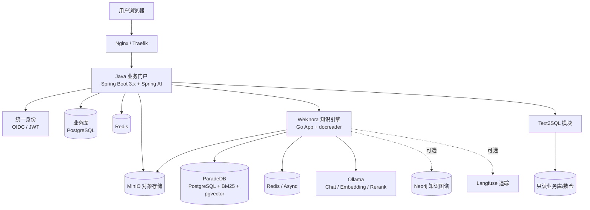
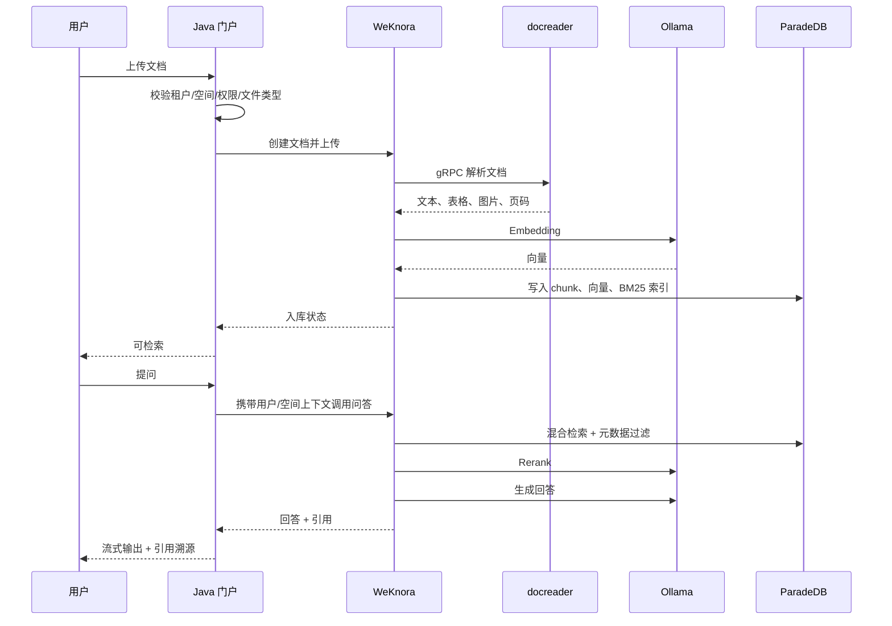
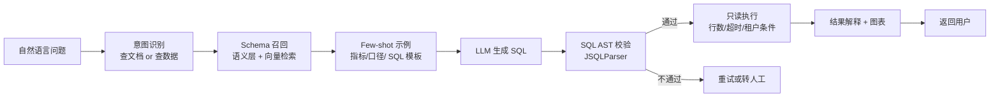

# 本地知识库市场调研与技术建设方案

## 1. 需求与约束

本方案基于以下已确认的建设约束：

| 维度 | 约束 |
|---|---|
| 部署方式 | 本地 Docker 部署，数据不出内网 |
| 技术路线 | Java 做业务层，成熟开源项目做 AI 引擎 |
| 大模型 | 纯本地模型（Ollama / vLLM） |
| 使用规模 | 小团队，少于 50 人 |
| 核心能力 | 文档问答（RAG）、知识沉淀与协作、权限与多租户隔离、结构化数据问答（Text2SQL） |

这组约束决定了两条基本判断：第一，小团队不适合维护一套从零自研的 RAG 全链路，成熟开源引擎应承担文档解析、切分、向量化、混合检索和重排；第二，权限、组织架构、业务流程和 Text2SQL 更适合放在 Java 业务层，避免被开源引擎的账号体系绑架。

本报告数据截止 2026-10-31。开源项目版本迭代较快，资源要求、许可证条款与功能范围在落地前需再次复核。

## 2. 结论摘要

推荐采用“**WeKnora 作为知识引擎 + Spring Boot Java 业务门户 + Ollama 本地模型 + PostgreSQL/pgvector + MinIO**”的混合架构。

选择 WeKnora 作为主引擎，核心原因是它在同一套开源项目中同时覆盖了本方案的四项关键能力中的三项：文档 RAG、知识 Wiki 与知识图谱、工作空间级 RBAC 与审计；并且原生支持 Ollama 和 pgvector，标准 Docker Compose 最低约 4 核 8GB 起步，适合 50 人以内团队。[cite:5][cite:6][cite:7]

RAGFlow 作为备选引擎，优势在复杂版式文档解析、深度文档理解和检索编排，许可证为 Apache 2.0，团队权限体系也较完整；但其默认依赖 Elasticsearch/MySQL/MinIO/Redis，官方建议 4 核 16GB、50GB 磁盘起步，资源占用明显高于 WeKnora，知识协作能力也需进一步验证。[cite:1][cite:2][cite:3]

Text2SQL 不建议在初期引入 DB-GPT 或 WrenAI 整套平台，而是在 Java 业务层实现“语义层 + Schema 检索 + SQL AST 校验 + 只读执行 + 结果解释”的轻量方案；当分析场景复杂到需要多表语义模型或数据分析 Agent 时，再引入 WrenAI 或 DB-GPT。[cite:13][cite:14]

## 3. 市场成熟方案调研

### 3.1 方案全景

当前可本地 Docker 部署、且具备知识库/RAG 能力的成熟开源方案，主要分为三类：

| 类型 | 代表项目 | 主要特征 |
|---|---|---|
| 深度 RAG 引擎 | RAGFlow、WeKnora | 文档解析、切分、混合检索、重排、引用溯源能力完整 |
| 企业知识库/智能体平台 | MaxKB、FastGPT、Dify | 知识库 + 工作流 + Agent + 对外集成，偏应用平台 |
| Java AI 框架 | Spring AI、LangChain4j | 提供模型调用、RAG 组件、向量库适配，不是成品知识库 |

对“小团队 + 本地模型 + 四项核心能力”的组合而言，成品开源项目应作为底座，Java 框架用于业务层和 Text2SQL 等定制能力，而不是用 Java 框架从零拼装一个知识库产品。

### 3.2 RAGFlow

RAGFlow 是当前开源 RAG 领域的代表性项目，定位为“深度文档理解 + 检索增强生成引擎”，许可证为 Apache 2.0。[cite:1]

核心能力：

- 基于 DeepDoc 的复杂文档理解，支持 Word、PPT、Excel、TXT、图片、PDF、扫描件、网页和结构化数据等异构格式。[cite:1]
- 模板化切分、可视化切分干预、引用溯源，强调“Quality in, quality out”。[cite:1]
- 多路召回与融合重排，支持可配置 LLM、Embedding 和 Reranker。[cite:1]
- 2026 年新增 Knowledge Compilation，可在文档和数据集级别生成 Wiki、图谱、树、PageIndex、思维导图、时间线和 Skills；同时引入 Agentic RAG，支持多步检索与 Low/Medium/High/Ultra 思考深度。[cite:1]
- 提供完整 REST API，便于 Java 业务系统集成。[cite:1]

部署与资源：

- 官方建议最低 4 核 CPU、16GB 内存、50GB 磁盘，Docker ≥ 24.0.0、Compose ≥ v2.26.1。[cite:2]
- 默认依赖 MySQL、Elasticsearch、Redis、MinIO 等组件；也可切换为自研 Infinity 检索引擎，官方说明 Infinity 更轻量、冷启动更快，但部分平台支持仍需确认。[cite:1][cite:20]
- Docker 镜像分 slim 与 full 版本，slim 不含内置 BGE/BCE 模型，约 1GB；full 约 9GB。[cite:4]

权限与协作：

- 通过团队成员、资源共享范围、资源操作权限三层管理协作与权限。[cite:3]
- 支持知识库、Agent、对话、搜索应用、记忆等资源的共享范围配置。[cite:3]

适合场景：扫描件、复杂表格、超长文档占比高，且团队愿意承担较高资源开销的 RAG 场景。

需要注意：RAGFlow 1.0 系列在 2026 年仍处于 RC 阶段，生产使用应锁定具体版本并做升级验证。[cite:1]

### 3.3 WeKnora

WeKnora 是腾讯开源的企业知识管理框架，许可证为 MIT，定位为“文档理解、语义检索、推理与知识组织”的一体化知识平台。[cite:5]

核心能力：

- RAG 问答：混合检索、多模态解析、引用溯源。[cite:5]
- Agent：多步推理、Skills、沙箱、本地浏览器、MCP 工具与记忆。[cite:5]
- Wiki：将知识库文档抽取为可浏览、可编辑、可回滚的 Wiki 页面，并提供知识图谱。[cite:5]
- 数据源与格式：支持飞书 Wiki/Drive、Confluence、GitLab、Notion、语雀、钉钉文档、Seafile、RSS 等同步；支持 PDF、Word、图片、Excel、XMind 等 10+ 格式，docreader 解析服务覆盖 25+ 格式。[cite:5][cite:6]
- 权限与运维：多工作空间 RBAC，Owner/Admin/Contributor/Viewer 四类角色，按资源归属和按工作空间审计日志；支持 OIDC、作用域 API Key、Langfuse 追踪。[cite:5]
- 模型：内置 27 家以上模型厂商目录，包含 Ollama、OpenAI、DeepSeek、Qwen、智谱、混元、Gemini、MiniMax 等。[cite:5]

技术架构：

- Web 前端 + Go 主服务 + Python 文档解析服务 docreader，三者为核心进程。[cite:6][cite:8]
- 默认数据库为 ParadeDB（PostgreSQL 17 发行版），自带 BM25 全文检索与 pgvector 向量能力，因此默认部署无需独立向量库。[cite:6]
- Redis + Asynq 负责任务队列；可选 Qdrant、Milvus、Weaviate、OpenSearch、Neo4j 知识图谱、MinIO 对象存储、Langfuse 追踪。[cite:6]
- 标准 Docker Compose 建议 4 核 CPU、8GB 内存起步，不含 Ollama 模型权重；docreader 内含 LibreOffice、Playwright，内存占用较高。[cite:7]
- 另有 Lite 单二进制模式：SQLite + sqlite-vec + 进程内任务队列，适合个人或低资源环境。[cite:6][cite:7]

适合场景：希望一套系统同时覆盖 RAG 问答、知识 Wiki 沉淀、权限隔离和本地模型接入的小团队。

需要注意：WeKnora 版本迭代较快，2026 年 10 月已发布 v0.9.0，生产使用应锁定版本、保留升级回滚方案，并重点关注数据库迁移说明。[cite:5]

### 3.4 MaxKB

MaxKB 是面向企业级智能体的开源平台，许可证为 GPLv3。[cite:9]

核心能力：

- RAG 管线：文档上传、在线文档抓取、自动切分、向量化、问答。[cite:9]
- Agentic Workflow、函数库、MCP 工具调用。[cite:9]
- 模型无关：支持 DeepSeek、Llama、Qwen 等私有模型，以及 OpenAI、Claude、Gemini、MiniMax 等公有模型。[cite:9]
- 多模态输入输出：文本、图片、音频、视频。[cite:9]

技术栈与部署：

- 前端 Vue.js，后端 Python/Django，LLM 框架 LangChain，数据库 PostgreSQL + pgvector。[cite:9]
- 单容器即可启动，`docker run` 一条命令拉起 Web UI，部署门槛最低。[cite:9]

适合场景：需要快速上线、以知识问答为主、对深度文档解析和知识协作要求不高的团队。

主要限制：GPLv3 在内部使用场景通常不触发分发义务，但对外分发或闭源商业集成需要重点评估许可证合规；同时其公开定位更偏知识问答与智能体，知识协作与细粒度多租户能力需要按实际版本进一步验证。[cite:9]

### 3.5 Dify

Dify 是通用 LLM 应用开发平台，许可证为 Apache 2.0 附加条件。[cite:10]

核心能力：

- 可视化 Workflow、Prompt IDE、RAG Pipeline、Agent、LLMOps、Backend-as-a-Service。[cite:10]
- 支持数百种专有/开源模型及 OpenAI API 兼容模型。[cite:10]
- 社区版最低 2 核 CPU、4GB 内存即可启动。[cite:10]

权限方面，SSO 与 RBAC 属于企业版能力，社区版不提供完整的企业级权限体系。[cite:10]

适合场景：以 AI 应用编排、工作流和 Agent 为核心，知识库只是其中一个模块的场景。

主要限制：知识库深度、文档解析和知识协作不是其最强项；若目标是“知识库产品”，Dify 更偏向“AI 应用平台”，需要额外开发。

### 3.6 FastGPT

FastGPT 是知识库增强的 AI 应用平台，许可证为 Apache 2.0 附加两项限制。[cite:11][cite:12]

核心能力：

- 知识库：多库复用与混用、chunk 修改删除、手动输入/直接分段/QA 拆分导入、TXT/MD/HTML/PDF/Docx/PPTX/CSV/XLSX、URL 读取、CSV 批量导入、混合检索与重排、API 知识库。[cite:11]
- 应用编排：Agent Skill、对话工作流、插件工作流、RPA 节点、双向 MCP。[cite:11]
- 调试与运营：知识库单点搜索测试、引用反馈与修改、完整调用链路日志、应用评测、免登录分享、iframe 嵌入。[cite:11]

许可证附加限制：若使用 fastgpt.io 源码运营类似的多租户 SaaS 服务，需要获得明确书面授权。[cite:12]

适合场景：需要“知识库 + 工作流 + Agent + 国内渠道发布”一体化交付的场景。

主要限制：技术栈以 Node/TypeScript 为主，与 Java 业务层的集成以 API 为主；许可证对多租户 SaaS 有额外限制。

### 3.7 Text2SQL 专项方案

结构化数据问答与文档 RAG 的链路差异很大，需要单独选型。当前主流开源方案有三类：

| 方案 | 思路 | 优势 | 局限 |
|---|---|---|---|
| Vanna | RAG-first，自学习 | 轻量、易嵌入、GitHub 约 22k stars | 缺对话记忆与复杂多表治理，复杂查询易失败 |
| WrenAI | 语义模型优先（MDL） | 业务定义、表关系、指标治理强，适合 GenBI | 需要维护语义层，部署组件较多 |
| DB-GPT | 多 Agent、工作流驱动 | 数据分析 Agent 能力完整，支持多数据库 | 体量大，本地模型建议 24GB 显存，运维成本高 |

上述对比来自对三个项目源码与定位的分析。[cite:13] DB-GPT 官方部署文档给出的本地模型建议为 8 核 32GB 内存、24GB 及以上显存。[cite:14]

对小团队而言，初期直接上 DB-GPT 或 WrenAI 会引入额外的 Python 技术栈和运维面。更合理的做法是先在 Java 业务层实现受控的 Text2SQL 能力，等复杂分析需求明确后再引入专业引擎。

### 3.8 Java AI 框架

Java 生态目前没有与 RAGFlow/WeKnora 对等的“成品知识库”，主要是框架级能力：

| 维度 | Spring AI | LangChain4j |
|---|---|---|
| 适用场景 | 已使用 Spring Boot 的应用 | Quarkus、Vert.x、Helidon、纯 Java 或响应式应用 |
| Spring Boot 3.x | 1.1.x 系列 | 支持 |
| Spring Boot 4 | 2.0 | 支持 |
| 模型提供方 | 约 8 个核心，其余外部扩展 | 20+ |
| 向量库 | 约 18 个 | 30+ |
| RAG 实现 | ETL + Advisor 链，QuestionAnswerAdvisor 自动检索注入 | 组件更细粒度，支持混合检索、重排等高级模式 |

以上版本与能力对比来自 2026 年的框架对比分析。[cite:15] Spring AI 官方提供 pgvector 等向量库的完整适配。[cite:16]

结论：本方案以 Spring Boot 为业务底座，优先使用 Spring AI；只有在需要更细粒度的混合检索/重排编排，或未来迁移到 Quarkus 时，才考虑 LangChain4j。

## 4. 横向对比

### 4.1 定位、许可证与部署成本

| 维度 | RAGFlow | WeKnora | MaxKB | Dify | FastGPT |
|---|---|---|---|---|---|
| 定位 | 深度 RAG 引擎 | 一体化知识管理框架 | 企业知识库智能体 | 通用 LLM 应用平台 | 知识库 AI 应用平台 |
| 许可证 | Apache 2.0 [cite:1] | MIT [cite:5] | GPLv3 [cite:9] | Apache 2.0 + 附加条件 [cite:10] | Apache 2.0 + 附加限制 [cite:12] |
| 主要技术栈 | Go 服务 + DeepDoc + MySQL/ES/MinIO/Redis [cite:1] | Go + Vue + Python docreader + ParadeDB/Redis [cite:6] | Python/Django + LangChain + PG/pgvector [cite:9] | Python + 多组件 [cite:10] | Node/TS + 多组件 [cite:11] |
| 最低资源 | 4C/16GB/50GB [cite:2] | 4C/8GB 起，不含模型权重 [cite:7] | 单容器，资源需求较低 [cite:9] | 2C/4GB [cite:10] | 未在本次资料中给出统一数值 |
| 本地模型 | 支持 Ollama 等 [cite:1] | 原生支持 Ollama 等 27+ 厂商 [cite:5] | 支持 Ollama/私有模型 [cite:9] | 支持 Ollama/OpenAI 兼容 [cite:10] | 支持主流模型 |
| 部署复杂度 | 中高 | 中 | 低 | 中 | 中 |

### 4.2 四项核心能力匹配度

| 能力 | RAGFlow | WeKnora | MaxKB | Dify | FastGPT |
|---|---|---|---|---|---|
| 文档 RAG | 强：DeepDoc、模板切分、混合检索、重排、引用 [cite:1] | 强：混合检索、多模态解析、引用 [cite:5] | 中强：RAG 管线完整 [cite:9] | 中：RAG Pipeline [cite:10] | 强：混合检索与重排 [cite:11] |
| 知识沉淀与协作 | 中：Knowledge Compilation 可生成 Wiki/图谱，协作编辑能力需验证 [cite:1] | 强：Wiki 页面、修订回滚、知识图谱 [cite:5] | 需按版本验证 | 弱 | 中 |
| 权限与多租户 | 中强：团队/共享范围/操作权限三层 [cite:3] | 强：多工作空间 RBAC 四角色 + 审计 [cite:5] | 需按版本验证 | 社区版弱，企业版 SSO/RBAC [cite:10] | 中 |
| Text2SQL | 无原生 | 无原生 | 无原生 | 可通过工作流/工具实现 | 可通过工作流/工具实现 |
| Java 集成 | REST API 完整 | REST API + MCP Server + OIDC [cite:5] | API | API | API |

### 4.3 选型判断

| 判断维度 | 结论 |
|---|---|
| 最适合作为主引擎 | WeKnora |
| 最适合复杂文档解析备选 | RAGFlow |
| 最适合极简部署 | MaxKB |
| 最适合 AI 应用编排 | Dify / FastGPT |
| 最适合 Java 业务层 | Spring Boot + Spring AI |
| Text2SQL 初期方案 | Java 自研受控 Text2SQL |
| Text2SQL 复杂场景备选 | WrenAI / DB-GPT |

## 5. 选型结论

### 5.1 主方案：WeKnora + Java 业务门户

推荐组合：

- **知识引擎**：WeKnora 标准 Docker Compose 部署，承担文档解析、切分、向量化、混合检索、重排、RAG 问答、Wiki 与知识图谱。
- **业务门户**：Spring Boot 3.x + Spring AI 1.1.x，承担统一登录、组织与角色、工作空间映射、文档生命周期、审批流程、Text2SQL、审计与对外集成。
- **模型服务**：Ollama 承载本地对话模型、Embedding 模型与 Reranker。
- **数据层**：ParadeDB/PostgreSQL 承载 WeKnora 业务数据、BM25 与 pgvector；Java 业务库独立 PostgreSQL；MinIO 承载原始文件。
- **前端**：Java 门户统一入口；知识库管理、Wiki 编辑可复用 WeKnora 原生 UI，通过 SSO 和权限映射接入。

选择理由：

1. 四项核心能力中，WeKnora 原生覆盖 RAG、知识协作、权限三项，Text2SQL 由 Java 层补齐，整体改造量最小。[cite:5]
2. 默认 ParadeDB 同时提供 BM25 与 pgvector，50 人以内团队无需再维护独立向量数据库；pgvector 适合 1 亿向量以内、需要关系数据与向量检索并存的场景。[cite:6][cite:19]
3. 标准部署 4 核 8GB 起步，明显低于 RAGFlow 的 4 核 16GB 起步要求。[cite:2][cite:7]
4. MIT 许可证对内部使用和后续商业化最友好。[cite:5]
5. 提供 OIDC、REST API、MCP Server 和作用域 API Key，适合 Java 业务层做统一身份与集成。[cite:5]

### 5.2 备选方案与切换条件

RAGFlow 作为备选引擎，在以下条件出现时切换或并行引入：

- 知识库中扫描件、复杂表格、双栏 PDF、图片型文档占比高，WeKnora 的解析质量不满足验收指标。
- 需要 RAGFlow 的 Agentic RAG 多步检索、Knowledge Compilation 或特定文档引擎能力。[cite:1]
- 团队能接受 16GB 以上内存和 Elasticsearch/Infinity 的运维成本。[cite:2]

切换方式：Java 业务层通过 RAGFlow REST API 对接数据集、文档、检索和对话接口，权限仍由 Java 层作为唯一事实源；RAGFlow 的团队权限体系可作为二级权限，不反向同步组织架构。[cite:1][cite:3]

### 5.3 不选方案及理由

| 方案 | 不选为主方案的理由 | 适用条件 |
|---|---|---|
| MaxKB | GPLv3 对外分发与闭源商业集成需评估；知识协作和细粒度多租户需按版本验证 [cite:9] | 仅内部使用、追求极简部署、以问答为主 |
| Dify | 定位是 AI 应用平台，知识库非其最强项；社区版缺 SSO/RBAC [cite:10] | 以工作流/Agent 编排为主，知识库为辅 |
| FastGPT | 多租户 SaaS 有附加授权限制；技术栈以 Node 为主 [cite:12] | 需要知识库 + 工作流 + 国内渠道发布 |
| Java 从零自研 | 缺少成熟成品可对标，文档解析、检索调优、权限体系工作量过大 | 有强定制需求且具备长期研发投入 |

## 6. 技术方案

### 6.1 总体架构

架构分为四层：

| 层次 | 组件 | 职责 |
|---|---|---|
| 接入层 | Nginx/Traefik、OIDC | TLS、反向代理、统一登录、限流 |
| 业务层 | Spring Boot、Spring AI、Spring Security | 组织权限、工作空间、文档生命周期、审批、Text2SQL、审计、集成 |
| AI 引擎层 | WeKnora、Ollama、ParadeDB、Redis | 解析、切分、向量化、检索、重排、问答、Wiki、知识图谱 |
| 基础设施层 | PostgreSQL、MinIO、备份、监控 | 业务数据、对象存储、备份恢复、可观测性 |

### 6.2 技术栈清单

| 模块 | 选型 | 版本建议 | 说明 |
|---|---|---|---|
| Java 运行时 | OpenJDK | 21 LTS | Spring Boot 3.x 基线 |
| 业务框架 | Spring Boot | 3.x LTS 系列 | Web、Security、Validation、Actuator |
| AI 框架 | Spring AI | 1.1.x | 与 Spring Boot 3.x 对应；提供 ChatClient、Advisor、pgvector 适配 [cite:15][cite:16] |
| 权限 | Spring Security + OAuth2/OIDC | 随 Boot | 对接企业 SSO，JWT 短有效期 |
| 业务数据库 | PostgreSQL | 16/17 | 组织、用户、权限、文档元数据、审计 |
| 缓存/锁 | Redis | 7.x | 会话、限流、分布式锁 |
| 对象存储 | MinIO | 最新稳定版 | 原始文档、解析产物、导出文件 |
| 知识引擎 | WeKnora | 锁定 v0.9.x | Go + docreader，Docker Compose 部署 [cite:5][cite:6] |
| 向量/全文检索 | ParadeDB pgvector + BM25 | 随 WeKnora | 默认无需独立向量库 [cite:6] |
| 本地模型服务 | Ollama | 最新稳定版 | 小团队低并发优先；高并发切换 vLLM [cite:17] |
| 可观测性 | Langfuse + Prometheus/Grafana | 可选 | 追踪 RAG 链路、Token、延迟 |
| 前端 | Vue 3 或 React | 最新稳定版 | 统一门户；知识管理复用 WeKnora UI |
| 部署 | Docker Compose | v2 | 单机部署；后续可迁移 Helm/K8s |

Java 业务层建议按领域拆分为以下模块：

| 模块 | 职责 | 与引擎的边界 |
|---|---|---|
| auth-service | OIDC 登录、JWT、会话、MFA | 向 WeKnora 提供身份，不存引擎会话 |
| org-service | 租户、部门、用户、角色 | 组织架构唯一事实源 |
| workspace-service | 工作空间、成员、知识库归属 | 映射 WeKnora 工作空间与角色 |
| doc-service | 上传、版本、密级、解析状态、归档 | 调用引擎文档 API，保存业务元数据 |
| chat-service | 问答编排、流式输出、引用展示、反馈 | 调用引擎检索/问答 API |
| wiki-service | 草稿、审核、发布、修订、回滚 | 内容写入引擎 Wiki，流程留在 Java |
| text2sql-service | 语义层、Schema 召回、SQL 校验与执行 | 不经过知识引擎 |
| audit-service | 操作审计、检索审计、导出审计 | 汇聚 Java 与引擎审计事件 |
| integration-service | MCP、开放 API、IM/邮件通知、Webhook | 对外集成统一出口 |

### 6.3 部署拓扑

单机 Docker Compose 建议包含以下服务：

| 服务 | 必需 | 说明 |
|---|---|---|
| nginx/traefik | 是 | 统一入口、TLS、路由 |
| knowledge-portal | 是 | Java 业务门户 |
| weknora-app | 是 | 知识引擎主服务 |
| weknora-docreader | 是 | Python 文档解析微服务 |
| paradedb | 是 | 业务数据 + BM25 + pgvector |
| redis | 是 | 队列与缓存 |
| minio | 是 | 原始文件与解析产物 |
| ollama | 是 | 本地模型推理 |
| langfuse | 否 | RAG 链路追踪 |
| neo4j | 否 | 知识图谱增强 |
| prometheus/grafana | 否 | 监控告警 |

资源建议：

| 场景 | CPU | 内存 | GPU 显存 | 磁盘 |
|---|---|---|---|---|
| 14B 模型、50 人以内、低并发 | 16 核 | 32GB | 16GB | 1TB NVMe |
| 32B 模型、50 人以内、中等并发 | 16 核 | 64GB | 24GB | 1TB NVMe |
| 仅 CPU 推理 | 16 核 | 64GB | 无 | 1TB NVMe |

说明：WeKnora 标准部署本身建议 4 核 8GB 起步，且不含模型权重；RAGFlow 官方最低为 4 核 16GB。[cite:2][cite:7] 本地模型显存按 Q4_K_M 量化估算，约每十亿参数 0.6GB 权重，另加 1–4GB 上下文开销；8GB 可跑 7B–8B，16GB 可跑 14B，24GB 可跑 27B–32B。[cite:18]

### 6.4 文档入库与检索链路

关键设计点：

- 文档入库前由 Java 层完成租户、空间、密级、文件类型和大小校验，防止越权上传。
- 解析失败、扫描件、超大文件进入异步补偿队列，保留原始文件和解析日志。
- chunk 元数据至少包含：租户 ID、空间 ID、知识库 ID、文档 ID、密级、部门、上传人、版本号，用于检索过滤和引用溯源。
- 检索链路采用“查询改写 → 并行召回（向量 + BM25）→ 融合 → 重排 → Prompt 组装 → 流式生成”，与 WeKnora 的 chat_pipeline 一致。[cite:6]
- 回答必须携带引用片段和原文定位，降低幻觉风险。[cite:5]

### 6.5 权限与多租户设计

权限模型分三层：

| 层级 | 主体 | 控制内容 |
|---|---|---|
| 平台层 | 租户/组织 | 租户隔离、全局管理员、配额 |
| 空间层 | 部门/项目工作空间 | 成员、角色、知识库归属、审计 |
| 文档层 | 知识库/文档 | 查看、编辑、下载、分享、密级 |

实现方式：

- Java 业务层是组织、用户、角色、空间和文档 ACL 的唯一事实源。
- 通过 OIDC 将用户身份同步到 WeKnora；工作空间成员与角色映射到 WeKnora 的 Owner/Admin/Contributor/Viewer 四类角色。[cite:5]
- 知识库按“部门/项目/密级”拆分，避免跨密级混检；高密级知识库独立工作空间。
- 文档级 ACL 以元数据标签写入引擎；检索时由 Java 层注入租户和空间过滤条件，必要时对召回结果做二次 ACL 过滤。
- 所有上传、下载、检索、问答、导出、权限变更写入审计日志；WeKnora 提供按工作空间审计日志能力。[cite:5]
- 若采用 RAGFlow 备选，其团队/共享范围/操作权限三层可作为二级权限，但组织架构仍由 Java 层维护。[cite:3]

### 6.6 知识沉淀与协作

知识沉淀分为“自动生成”和“人工运营”两条线：

| 环节 | 设计 |
|---|---|
| 自动生成 | WeKnora Wiki 从知识库文档抽取人物、产品、概念，生成带引用的页面，并以目录组织；知识图谱展示页面关系。[cite:5] |
| 人工编辑 | Wiki 页面支持直接编辑，修订历史可回滚。[cite:5] |
| 审核发布 | Java 层增加“草稿 → 审核 → 发布 → 归档”流程，审核通过后回写 WeKnora |
| 知识运营 | 文档负责人、有效期、密级、标签、关联文档；到期提醒与失效下架 |
| 质量闭环 | 用户对回答点踩/纠错，生成待办；运营人员修订 chunk 或 Wiki 页面 |

小团队不需要复杂的知识治理矩阵，建议先落地“部门知识库 + Wiki + 负责人 + 审核发布”四项，避免流程过重。

### 6.7 Text2SQL 设计

初期在 Java 业务层实现，不引入额外 Python 平台。核心链路：

关键约束：

- 语义层：维护表、字段、业务别名、指标口径、表关系、枚举值、时间字段和权限字段，作为 Schema 召回与 Prompt 的依据。
- Schema 召回：对语义层做向量化，按问题召回相关表和字段，避免把整库 Schema 塞入 Prompt。
- SQL 安全：只允许 SELECT；使用 AST 解析校验表/字段白名单、禁止 DDL/DML/系统函数；强制注入租户过滤条件；限制返回行数、执行超时和并发。
- 数据源：使用只读账号连接业务库或只读副本，禁止直连生产主库。
- 结果可信：展示生成的 SQL、执行计划摘要、数据口径和查询时间；对聚合结果给出解释。
- 审计与评测：记录问题、SQL、结果、耗时、用户反馈；建立 50–100 条基准问题集持续评测。

当出现以下情况时引入专业引擎：

- 需要跨多库、多表、复杂指标和多轮分析对话。
- 业务方要求语义层由分析团队统一维护，而不是由研发硬编码。
- 需要生成复杂报表或 GenBI 能力。

此时可选 WrenAI（MDL 语义层）或 DB-GPT（数据分析 Agent）；DB-GPT 本地模型部署建议 8 核 32GB、24GB 显存。[cite:13][cite:14]

### 6.8 本地模型选型

| 用途 | 推荐模型 | 说明 |
|---|---|---|
| 对话/问答 | Qwen3 14B/32B、DeepSeek 蒸馏版 | 中文能力好；14B 适合 16GB 显存，32B 适合 24GB 显存 [cite:18] |
| Embedding | BGE-M3 或 Qwen3-Embedding | BGE-M3 支持多语言与稠密+稀疏混合检索；Qwen3-Embedding 适合多语言语料 |
| Reranker | BGE-Reranker-v2-M3 | 对 Top 20–50 候选做精排，提升引用准确率 |
| 推理框架 | Ollama（默认）/ vLLM（高并发） | 1–5 并发用户 Ollama 更快更简单；超过 4 路并发后 vLLM 连续批处理吞吐优势明显，高并发可达 10–20 倍。[cite:17] |

模型部署建议：

- 小团队初期使用 Ollama，降低运维复杂度；将 Ollama 与 WeKnora、Java 门户放在同一 Docker 网络，通过内网地址调用。[cite:7]
- 当并发稳定超过 5 路，或需要更高吞吐和更低 P95 延迟时，切换 vLLM，保留 OpenAI 兼容接口，业务层无需改动。[cite:17]
- 模型文件、Prompt、评测集纳入版本管理；升级模型前先在评测集上回归。

### 6.9 可观测性与运维

| 能力 | 方案 |
|---|---|
| RAG 链路追踪 | Langfuse：记录检索、重排、Prompt、Token、延迟；WeKnora 原生支持 [cite:5] |
| 指标监控 | Prometheus + Grafana：QPS、P95 延迟、错误率、GPU 显存、队列积压 |
| 日志 | 结构化日志 + 集中检索；审计日志独立保留 |
| 备份 | PostgreSQL 每日全量 + WAL 归档；MinIO 版本化；配置与模型清单备份 |
| 升级 | 锁定 WeKnora 版本；升级前阅读数据库迁移说明并做快照 [cite:5] |
| 容量 | 文档量、chunk 数、向量维度、索引大小、GPU 显存周报 |

### 6.10 安全与合规

- 网络：知识库服务仅内网访问，不暴露公网；管理后台与用户入口分离。
- 身份：统一 OIDC 登录，JWT 短有效期，刷新令牌轮换；管理员强制多因素认证。
- 授权：最小权限原则；文档下载与水印可配置；高密级知识库独立空间。
- 数据：传输 TLS；对象存储服务端加密；数据库磁盘加密；备份加密。
- 模型：Prompt 中加入指令层级与检索内容边界，防御提示注入；对输出做敏感信息过滤。
- Text2SQL：只读账号、AST 白名单、租户条件强制注入、行数与超时限制、全量审计。
- 供应链：锁定镜像 digest；定期扫描漏洞；开源许可证清单归档。

## 7. 实施路径

| 阶段 | 目标 | 主要工作 | 退出条件 |
|---|---|---|---|
| P0 选型验证 | 用真实文档验证引擎 | 部署 WeKnora + Ollama；导入 50–100 份真实文档；对比 WeKnora 与 RAGFlow 的解析、检索、引用效果 | 核心问题集 Recall@5 和引用准确率达到门槛 |
| P1 基础平台 | 跑通“登录 → 空间 → 上传 → 问答” | Java 门户、OIDC、组织/空间/角色、文档上传、引擎 API 对接、流式问答、引用展示 | 50 人内可稳定使用，权限测试通过 |
| P2 知识协作 | 知识可沉淀、可运营 | Wiki 页面、审核发布、负责人/有效期、纠错闭环、审计 | 部门知识库完成一轮运营 |
| P3 Text2SQL | 结构化数据可问答 | 语义层、Schema 召回、SQL 生成与校验、只读执行、图表、评测集 | 基准问题集执行成功率达到门槛 |
| P4 优化与运维 | 稳定、可观测、可扩展 | 混合检索与重排调优、缓存、监控告警、备份恢复演练、容量评估 | 完成一次故障演练与恢复演练 |

## 8. 验收指标

| 类别 | 指标 | 目标值 |
|---|---|---|
| 检索质量 | 核心问题集 Recall@5 | ≥ 85% |
| 回答质量 | 引用准确率（引用片段能支撑结论） | ≥ 90% |
| 回答质量 | 无依据断言比例 | ≤ 5% |
| 性能 | 首 Token 延迟 P95 | ≤ 3 秒（14B 本地模型） |
| 性能 | 完整回答 P95 | ≤ 15 秒（常规问题） |
| 并发 | 20 并发下错误率 | ≤ 1% |
| 权限 | 跨租户/跨空间越权访问 | 0 例 |
| Text2SQL | 基准问题集执行成功率 | ≥ 80% |
| Text2SQL | 危险 SQL 拦截率 | 100% |
| 运维 | 备份恢复演练 | 可恢复到指定时间点 |

指标为目标建议值，需在 P0 阶段用真实语料校准。

## 9. 风险与对策

| 风险 | 影响 | 对策 |
|---|---|---|
| WeKnora 迭代快、版本较新 | 升级引入不兼容 | 锁定版本与镜像 digest；升级前快照；保留回滚；关注迁移说明 [cite:5] |
| 本地模型能力弱于云端 | 回答质量不达标 | 建立评测集；14B 起步，必要时升级 32B；优化 Prompt 与重排；保留模型切换能力 |
| Ollama 并发能力有限 | 高峰期排队 | 5 路以上并发切换 vLLM；队列与限流；异步任务削峰 [cite:17] |
| 复杂 PDF/扫描件解析差 | 检索召回低 | P0 用真实文档验证；不达标时引入 RAGFlow 作为解析/检索备选 [cite:1] |
| 文档级 ACL 与引擎能力不匹配 | 越权风险 | 按密级拆分知识库；Java 层二次过滤；权限专项测试 |
| Text2SQL 生成危险 SQL | 数据泄露或误操作 | 只读账号、AST 白名单、租户条件注入、行数/超时限制、审计 [cite:14] |
| GPLv3 或许可证附加条款 | 商业化合规风险 | 主方案选 MIT 的 WeKnora；MaxKB/FastGPT/Dify 仅在合规评估后使用 [cite:9][cite:10][cite:12] |
| 单机故障 | 服务中断 | 每日备份；关键卷快照；后续可迁移 Helm/K8s；准备降级只读模式 |

## 10. 结论

对“小团队、本地 Docker、纯本地模型、Java 业务层”的组合，最稳妥的建设路径是：

1. 以 WeKnora 作为知识引擎，先用真实文档完成 P0 验证，锁定版本。
2. 以 Spring Boot + Spring AI 建设统一门户，掌握身份、权限、流程和审计的主动权。
3. 以 Ollama 承载 14B/32B 对话模型、BGE-M3 Embedding 和 BGE-Reranker，控制显存与并发成本。
4. 以 ParadeDB/pgvector 作为默认检索底座，50 人以内不引入独立向量库。
5. Text2SQL 先在 Java 层做受控实现，复杂分析需求明确后再引入 WrenAI 或 DB-GPT。
6. 用 RAGFlow 作为复杂文档解析的备选，而不是默认双引擎并行，避免小团队承担双份运维成本。

该方案的核心权衡是：用 WeKnora 换取“开箱即用的知识协作与权限能力”，用 Java 业务层换取“组织、流程和结构化数据问答的可控性”，用 Ollama/pgvector 换取“本地化与低运维成本”。当文档解析质量或并发规模超出小团队基线时，再按既定触发条件引入 RAGFlow 或 vLLM。

## Sources

- [cite:1] [RAGFlow GitHub README](https://github.com/infiniflow/ragflow)
- [cite:2] [RAGFlow Get Started](https://ragflow.io/docs/dev/)
- [cite:3] [RAGFlow Permission System Overview](https://ragflow.io/docs/permission_system_overview)
- [cite:4] [RAGFlow Release Notes](https://ragflow.io/docs/release_notes)
- [cite:5] [WeKnora GitHub README](https://github.com/Tencent/WeKnora)
- [cite:6] [WeKnora 总体架构](https://weknora.weixin.qq.com/docs/02-architecture/01-overview)
- [cite:7] [WeKnora 安装部署](https://weknora.weixin.qq.com/docs/01-getting-started/02-installation)
- [cite:8] [WeKnora 产品介绍](https://weknora.weixin.qq.com/docs/01-getting-started/01-introduction)
- [cite:9] [MaxKB GitHub README](https://github.com/1Panel-dev/MaxKB)
- [cite:10] [Dify GitHub README](https://github.com/langgenius/dify)
- [cite:11] [FastGPT GitHub README](https://github.com/labring/FastGPT)
- [cite:12] [FastGPT 开源协议](https://doc.fastgpt.cn/zh-CN/guide/version/opensource/license)
- [cite:13] [Dissecting Open-Source NL2SQL: Vanna, WrenAI, DB-GPT](https://sudiptapathak.com/blog/dissecting-open-source-nl2sql/)
- [cite:14] [DB-GPT 源码部署](http://docs.dbgpt.cn/zh-CN/docs/installation/sourcecode/)
- [cite:15] [Spring AI vs LangChain4j: Which Java AI Framework to Pick in 2026](https://patotski.com/blog/spring-ai-vs-langchain4j/)
- [cite:16] [Spring AI PGvector Reference](https://docs.spring.io/spring-ai/reference/api/vectordbs/pgvector.html)
- [cite:17] [vLLM vs Ollama in 2026: When Each One Wins](https://www.runaihome.com/blog/vllm-vs-ollama-when-each-wins-2026/)
- [cite:18] [How Much VRAM Do You Need for Local LLMs? (2026)](https://modelfit.io/blog/how-much-vram-for-llms/)
- [cite:19] [Best Vector Databases in 2026](https://www.firecrawl.dev/blog/best-vector-databases)
- [cite:20] [RAGFlow: Self-Host a Deep-Document RAG Engine](https://effloow.hashnode.dev/ragflow-self-hosted-rag-agent-engine-guide-2026)
