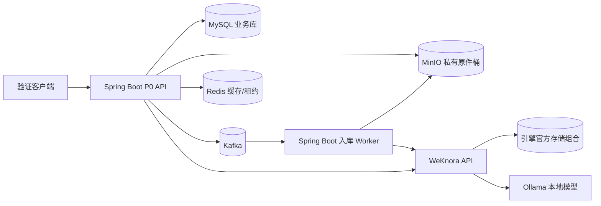

# P0 专项工作方案：本地知识库技术验证与规格冻结

**关联方案**：`本地知识库完整实现技术方案.md` 第 15.2 节  
**阶段周期**：约 2 周（10 个工作日）  
**阶段定位**：技术验证与规格冻结；不建设完整产品，不向业务用户开放  
**指定技术栈**：Spring Boot + MySQL + MyBatis + MinIO + Redis + Kafka  
**知识能力组件**：WeKnora（候选知识引擎）+ Ollama（本地推理）；引擎自身依赖按官方兼容组合单独部署

---

## 1. P0 目标与决策原则

P0 要用可复现的小型纵向切片证明关键架构可行，给 P1 提供可执行、低返工的技术规格。阶段结束必须回答：

1. 目标机器能否在断网条件下运行解析、索引、检索、问答和引用？
2. Java 业务侧能否用 MySQL/MyBatis 管理用户、权限、文档元数据和生命周期，同时用 MinIO 保存权威原件？
3. Kafka 入库事件是否可做到至少一次投递、幂等消费、失败重试和死信处置？Redis 是否仅承担可重建的缓存/短租约，故障时不会造成权限放宽或任务丢失？
4. WeKnora 能否满足服务端 ACL 前置过滤、撤权生效和引用授权要求？
5. 实际语料上的解析/检索质量、5 并发延迟与资源占用是否达到业务门槛？
6. OpenAPI、事件契约、状态机、错误码、依赖版本和部署参数能否冻结？

所有验收结论需附环境、版本、数据集、执行步骤、原始结果和责任人。指标未达标时形成带责任人和复测日期的 ADR；安全隔离、断网运行或数据可恢复性失败属于阻断项。

## 2. 范围与明确不做事项

### 本阶段交付

- 目标机器上的可重复 Docker Compose 验证环境；所有镜像固定版本和摘要，不用 `latest`。
- Spring Boot 验证 API：身份映射桩/测试身份、知识库授权、单文件上传、任务状态、问答检索代理、引用授权代理。
- MySQL + MyBatis 数据模型与迁移脚本；MinIO 私有桶原件存储；Kafka 入库任务事件；Redis 可失效缓存/短租约验证。
- 真实文档样本和标注问答集；权限负向用例、故障注入记录、质量与容量基线。
- OpenAPI 3.1、Kafka 事件 schema、状态枚举、错误码、配置清单、ADR、P1 边界与 backlog 草案。

### 不在 P0 范围

完整前端、完整 OIDC/组织管理体验、生产级多租户运营控制台、Wiki 审批、Text2SQL、多节点高可用、自动扩缩容、正式迁移全量文档。P0 可使用 OIDC 测试租户或受控测试身份模拟认证，但授权判定必须在 Java 服务端完成。

## 3. P0 总体架构和责任边界



- **Spring Boot**：认证主体映射、租户/空间/知识库授权、API、审计、入库编排、引擎适配、引用代理。Controller 不直接访问引擎或 MinIO。
- **MySQL + MyBatis**：业务事实源，保存租户/用户映射、空间成员、知识库、文档版本、任务状态、幂等键、引擎 ID 和审计摘要。数据库迁移用 Flyway；禁止把权限事实放 Redis。
- **MinIO**：原始文件唯一权威副本。对象键由服务端生成，桶私有；业务表持有 object key、SHA-256、版本、大小和 MIME。
- **Kafka**：异步入库和删除事件通道。采用事务 Outbox：业务事务写 document/ingest_task/outbox，发布器投递 Kafka 后标记；消费者至少一次处理，以 document_id + version + operation_id 去重。配置重试主题与 DLQ；不以 Kafka offset 代替业务状态。
- **Redis**：只放可重建缓存（如短时 KB 元数据）和有界短租约/限流计数。所有授权请求缓存需带权限版本或短 TTL，撤权主动失效并在读取时验证；Redis 故障时回源 MySQL或拒绝，不允许放行。不得用 Redis 作为任务唯一存储。
- **WeKnora**：解析、切分、索引、检索及 RAG，通过 `KnowledgeEnginePort` 适配器访问；不直连其数据库，不把引擎文档 ID 当业务主键。P0 验证 ACL 能否在召回前过滤；若无法证明，停止直接集成并设计隔离层。
- **Ollama**：内网本地推理，禁止任何云端回退；记录模型名称、量化、校验和及参数。

> MySQL 是 Java 业务库；若 WeKnora 官方部署需要 PostgreSQL/向量扩展，则其作为知识引擎内部依赖独立运行，不替代业务 MySQL。P0 必须验证二者可通过稳定 API 协作，不能为统一数据库而擅自改写引擎存储。

## 4. 关键数据与事件契约

### 4.1 P0 最小表集

| 表 | 核心字段/约束 | P0 用途 |
|---|---|---|
| `tenant` | `id`, `code`, `status` | 测试租户隔离 |
| `app_user` | `id`, `issuer`, `subject`, `tenant_id`, `status`; `(issuer,subject)` 唯一 | 身份映射，不以邮箱作身份键 |
| `workspace` | `id`, `tenant_id`, `code`, `status` | 授权边界 |
| `workspace_member` | `workspace_id`, `user_id`, `role`; 联合唯一 | 成员权限 |
| `knowledge_base` | `id`, `tenant_id`, `workspace_id`, `engine_kb_id`, `acl_version`, `status` | 引擎映射及授权版本 |
| `document` | `id`, `tenant_id`, `kb_id`, `version`, `object_key`, `sha256`, `size_bytes`, `mime_type`, `status`, `engine_doc_id`; `(kb_id,sha256,version)` 唯一 | 原件和索引映射 |
| `ingest_task` | `id`, `document_id`, `operation_id`, `status`, `attempts`, `next_run_at`, `lease_until`, `error_code`; operation 唯一 | 任务生命周期和重放 |
| `outbox_event` | `event_id`, `aggregate_id`, `event_type`, `payload`, `created_at`, `published_at` | DB 与 Kafka 可靠衔接 |
| `audit_event` | `id`, `tenant_id`, `actor_id`, `action`, `resource_id`, `result`, `request_id`, `created_at` | 记录操作摘要，不存正文/Token |

主键使用应用生成 UUID（MySQL 可用 `BINARY(16)`，API 使用标准 UUID 字符串）；时间统一 UTC 存储。所有查询显式携带 tenant/workspace 边界。MyBatis Mapper 不提供绕过授权服务的通用查询入口。

### 4.2 Kafka 事件

主题建议：`kb.ingest.requested.v1`、`kb.ingest.retry.v1`、`kb.ingest.dlq.v1`、`kb.document.delete.v1`。按 `document_id` 分区以保持单文档顺序。事件采用 JSON Schema 或 Protobuf（二选一，P0 冻结），包含：

```json
{
  "eventId": "uuid",
  "eventType": "DOCUMENT_INGEST_REQUESTED",
  "schemaVersion": 1,
  "occurredAt": "UTC timestamp",
  "tenantId": "uuid",
  "documentId": "uuid",
  "documentVersion": 1,
  "operationId": "uuid",
  "correlationId": "uuid"
}
```

消费者先以 `eventId/operationId` 幂等认领任务，再读取 MySQL 当前状态；下载 MinIO 原件并核对 SHA-256 后调用引擎。引擎成功后持久化 `engine_doc_id` 和状态，再提交 offset。失败分为可重试、永久错误和需人工补偿；超过重试上限进 DLQ，运维入口不得直接重放未审计消息。评估 Kafka `acks=all`、生产幂等、复制因子（单机 P0 可为 1，需注明不具备 HA）、消费者手动提交、重试退避、消息保留和磁盘容量。

### 4.3 文档状态机

`UPLOADED -> QUEUED -> PARSING -> INDEXING -> READY`；可重试失败保持任务可恢复，永久错误转 `FAILED`；删除走 `DELETING -> DELETED`。每次迁移校验前置状态并记录操作者/原因。重复上传、事件重复投递、消费者重启和引擎超时都不得生成重复有效索引。

## 5. 两周执行计划（10 个工作日）

| 日程 | 工作包 | 具体执行 | 可检查产出/评审点 |
|---|---|---|---|
| 第 1 天 | 启动与样本盘点 | 确定目标机器/CPU/GPU/内存/磁盘、部署网络、身份源；收集 50–100 份脱敏文件，统计格式、大小和扫描比例；定义 100 个问题与来源标注规则 | P0 章程、样本清单及脱敏记录、环境基线、问题集标注模板 |
| 第 2 天 | 锁版本和部署骨架 | 锁定 JDK/Spring Boot/MySQL/MinIO/Redis/Kafka/WeKnora/Ollama 候选版本与镜像摘要；准备隔离网络 Compose、secrets、健康检查、资源采集 | 可重复启动的基础 Compose、SBOM/镜像清单初版、依赖兼容 ADR |
| 第 3 天 | Java 与业务库切片 | 建 Spring Boot 验证 API；MyBatis + Flyway 建最小表；实现测试身份映射、租户/成员/Kb 授权服务和审计摘要 | 数据迁移脚本、授权 API、跨租户基础用例、OpenAPI 草案 |
| 第 4 天 | 文件权威存储 | 实现上传校验、私有 MinIO 写入、SHA-256、幂等键、document/task/outbox 同事务；故障时避免 DB 指向未完成对象 | 上传纵向切片、对象 hash 清单、重复上传与部分失败记录 |
| 第 5 天 | Kafka 可靠任务 | Outbox publisher、消费者、幂等认领、重试/DLQ、任务状态 API；注入重复消息、消费中断、Kafka 暂停 | 事件 schema、重放脚本、重复投递结果、任务恢复记录 |
| 第 6 天 | 引擎接入与入库 | 实现 `KnowledgeEnginePort`/WeKnora adapter；worker 从 MinIO 取原件并调用引擎；核验解析输出和文档状态 | 入库链路可重复运行；支持格式矩阵和解析差异记录 |
| 第 7 天 | ACL 与问答引用 | 在检索前按服务端身份构造 scope；对引擎召回结果逐条二次校验 tenant/workspace/KB/document/版本/ACL；引用经 Java 授权代理读取 | 越权攻击用例、撤权时序、引用访问记录；任何漏权为阻断 |
| 第 8 天 | 质量、容量和离线 | 用固定语料跑解析、Recall@5、MRR、引用支持率；5 并发问答及入库；断公网冷启动、上传、问答；采集 GPU/RAM/CPU/磁盘和时延 | 评测报告、资源曲线、问题样例、无公网依赖证据 |
| 第 9 天 | 故障恢复与备份 | Redis/Kafka/MinIO/引擎/模型逐项故障注入；验证原件重建索引、任务重放、MySQL+MinIO+引擎一致检查点和隔离恢复 | 恢复演练记录、孤儿对象/索引核对、缺口及补偿措施 |
| 第 10 天 | 契约冻结与评审 | 冻结 API/SSE、Kafka schema、状态/错误码、上传上限、依赖摘要、运维配置；评审安全/质量/性能门槛并形成 go/no-go | P0 验收包、ADR 决议、P1 backlog、阻断项责任人/复测日期 |

## 6. 验证用例和验收方法

### 6.1 功能与可靠性

- 上传同一文件/幂等键多次：只产生约定版本和一个有效任务；SHA-256 一致。
- MinIO 写成功但 MySQL 事务失败、MySQL 成功后 Outbox publisher 中断、Kafka 重复消息、worker 重启、WeKnora 超时：最终状态可恢复，不重复有效索引。
- 删除重复请求幂等；引擎删除失败进入补偿态，原件按保留策略处理；确认引擎不可检索后方可完成删除。
- Redis 清空/不可用：授权回源或拒绝；不能出现缓存旧权限放行。缓存键带 tenant 和 ACL 版本，不存完整敏感回答。
- Kafka 不可用时 Outbox 留存、积压可观测；Kafka 恢复后按序消费；DLQ 可审计、可限权重放。

### 6.2 ACL 负向测试矩阵

覆盖跨租户、跨空间、未授权 KB、文档 ACL、密级不匹配、已撤权会话、旧引用 URL、伪造客户端 KB 列表、引擎返回越界 chunk、权限同步中断。每个用例确认：

1. 引擎请求范围来自 Java 服务端授权结果；
2. 越权 chunk 在进入模型 Prompt 前被剔除；
3. 引用预览每次请求重新授权，不暴露长期 MinIO URL；
4. 撤权后旧会话和旧引用不能绕过实时授权；
5. WeKnora 无法进行召回前 ACL 过滤时，不以仅靠结果后过滤作为通过条件，进入架构阻断评审。

### 6.3 质量与性能

建议按原方案设初始门槛，并以目标机器实际结果确认：

- 语料：50–100 份脱敏真实文档，覆盖 PDF/DOCX/XLSX/PPTX/Markdown/扫描 PDF 及实际常见格式；至少 100 个带标准来源片段问题。
- 检索：Recall@5 建议 ≥85%，MRR 一并报告；引用支持率建议 ≥90%，无答案集检查拒答表现。
- 并发：5 路问答，首 Token P95 建议 ≤8 秒、完整回答 P95 建议 ≤45 秒；报告冷启动、稳定态、队列等待和异常值。
- 摄取：记录每格式解析成功率、每分钟页数/文件数、入库排队时间、重试率、MinIO 与引擎存储增长。
- 资源：CPU/RAM/GPU 显存、模型加载耗时、MySQL 连接池、Kafka lag、Redis 内存、MinIO 磁盘和引擎存储峰值。
- 离线：切断公网 DNS/出口后从冷启动开始完成上传、索引、提问和引用；抓取外连日志证明无静默云回退。

### 6.4 备份恢复一致性

建立 `checkpoint_id`：暂停上传、删除和索引重建，待在途任务收敛；记录业务 MySQL 快照、引擎官方备份、MinIO 对象版本/哈希清单、模型清单。隔离环境恢复后核对每个抽样 document/version、object key/hash、engine_doc_id、引用和 ACL。若引擎索引无法可靠恢复，必须证明可由 MySQL + MinIO 原件重建。P0 至少完成一次端到端演练并记时；RPO/RTO 目标由业务负责人批准。

## 7. P0 API 与事件契约草案

### REST API（OpenAPI 3.1 冻结）

| 方法/路径 | 用途 | 关键行为 |
|---|---|---|
| `POST /api/v1/workspaces/{workspaceId}/knowledge-bases/{kbId}/documents` | 单文件上传 | `multipart/form-data`；`Idempotency-Key` 必填；权限校验后写 MinIO；返回 202 + documentId/taskId |
| `GET /api/v1/documents/{documentId}` | 文档与入库状态 | 每次校验租户和资源权限；支持 ETag |
| `POST /api/v1/documents/{documentId}/retry` | 重试失败任务 | 仅暂时性失败/授权角色；创建新 operationId，保留审计 |
| `DELETE /api/v1/documents/{documentId}` | 删除 | 幂等 Saga；先冻结检索，再删引擎索引，最后按保留策略处理原件 |
| `POST /api/v1/knowledge-bases/{kbId}/chat` | 验证问答 | 服务端构造 ACL scope；返回 answer/citations/requestId；P0 可用非流式先验证，SSE schema 同时冻结 |
| `GET /api/v1/citations/{citationId}/preview` | 授权引用预览 | 实时授权代理；禁止返回永久/长时预签名 URL |

错误响应统一 `{code,message,requestId,details?}`；冻结 400/401/403/404/409/413/422/429/500/503 对应的业务错误码。错误消息不泄露对象键、Prompt、凭据或内部堆栈。

### Kafka 事件契约

事件 schema 版本化，兼容性检查纳入 CI。所有事件携带 `eventId`、`eventType`、`schemaVersion`、`occurredAt`、`tenantId`、`documentId`、`documentVersion`、`operationId`、`correlationId`。大文件和敏感原文不得放 Kafka payload，仅传业务 ID 与必要元数据。

## 8. 安全、部署与观测要求

- Compose 私有 backend 网络；只有反向代理/API 验证入口对宿主机开放。MySQL、Redis、Kafka、MinIO 控制台、WeKnora、Ollama API 不直接发布到公网。
- secrets 通过受控文件/Compose secrets 注入；日志屏蔽密码、token、对象凭据和敏感正文；所有镜像 pin 版本并记录 digest。
- Spring Boot Actuator 只暴露必要健康端点；上传限流、文件签名/MIME/大小校验、随机对象键；P0 的杀毒可作为环境能力验证项。
- traceId/correlationId 贯穿 API、MySQL 任务、Kafka header、worker、引擎请求和审计；记录 Kafka lag、Outbox backlog、任务分布、引擎延迟、ACL 丢弃数、模型首 Token/总时延、资源水位。
- Redis 只作为优化层；Kafka 和 MinIO 容量需设置上限、保留策略和磁盘告警。业务数据不可通过日志导出内网。

## 9. 退出标准与 Go/No-Go

### 必须通过（硬门槛）

- 跨租户/空间/KB/文档读取越权为 0；召回阶段 ACL 过滤有效且可复现；撤权后检索和引用访问拒绝。
- 断公网仍能冷启动、上传、入库、问答和打开授权引用；无云端模型回退。
- MinIO 原件哈希校验通过；Kafka 重复投递、worker 重启和引擎短故障后最终状态可恢复；无重复有效索引。
- MySQL、MinIO 和引擎数据完成一次隔离恢复或权威原件重建演练；所有依赖固定版本且无 `latest`。

### 目标门槛（未达标需评审签署例外）

- Recall@5 ≥85%、引用支持率 ≥90%。
- 5 并发首 Token P95 ≤8 秒、完整回答 P95 ≤45 秒。
- 文件格式覆盖、上传上限和容量 SLO 基于实测由业务/技术负责人确认。

### Go/No-Go 决议

- **Go**：硬门槛全部通过；目标门槛通过或例外有批准人、风险、缓解措施、复测日期；依赖摘要、API/事件契约冻结。
- **Conditional Go**：非安全问题有明确临时限制和期限，不迁移正式数据。
- **No-Go**：权限召回过滤无法证明、断网链路失败、原件/索引不可恢复、存在静默云回退。记录替代引擎/隔离层或部署条件后重新评审。

## 10. P0 交付目录建议

```text
p0/
├── compose/                 # 验证环境 Compose 与非密钥配置样例
├── portal-poc/              # Spring Boot 验证 API/Worker
├── db/migration/            # Flyway MySQL migrations
├── contracts/
│   ├── openapi.yaml
│   └── kafka/                # 事件 schema 与样例
├── evaluation/
│   ├── corpus-manifest.csv  # 仅清单与 hash；样本按权限单独保存
│   ├── questions.csv
│   └── reports/
├── scripts/                 # 启停、离线检查、故障注入、恢复、评测
└── decisions/                # ADR、版本锁定与 Go/No-Go 记录
```

样本原件不得随普通代码提交；脚本、报告需能在授权机器上复现。P0 通过后将验证代码中可复用模块迁入正式工程，避免把临时 POC 当生产代码直接扩展。

## 11. P0 会议节奏与角色

- 第 1 天启动会：业务负责人确认样本、权限边界、目标机器、数据级别和验收人。
- 每日 15 分钟同步：完成项、次日目标、阻断风险；阻断项当日登记 ADR/责任人。
- 第 5 天中期评审：检查入库纵向切片、Kafka 可靠性和技术兼容性；若 ACL 能力明显不支持，立即切换隔离层验证。
- 第 10 天 Go/No-Go：业务、Java、平台/运维、安全、数据代表共同签署指标和例外。

| 角色 | 责任 |
|---|---|
| 业务/知识负责人 | 样本与问题集、质量阈值、引用可接受性 |
| Java 技术负责人 | API、MySQL/MyBatis、授权、Outbox、Kafka 消费和审计 |
| 平台/运维 | Compose、网络、资源采集、镜像/模型离线包、备份恢复 |
| 安全/数据负责人 | ACL 攻击面、脱敏、审计字段、数据留存和例外签字 |
| 验收人 | 检查证据包并作 Go/No-Go 决策 |

---

**文档状态**：P0 专项设计稿，实施前需填写目标硬件、候选版本摘要、样本来源和验收责任人；涉及引擎 ACL、存储兼容和资源指标的结论必须以实测为准。
