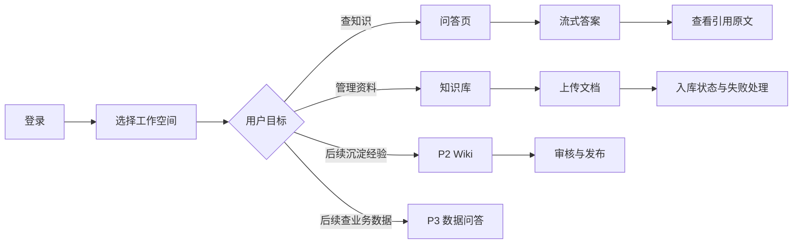

# 本地知识库前端实现方案

**版本：** 1.0  
**日期：** 2026-10-31  
**风格方向：** 苹果风格启发的轻盈、克制、清晰界面  
**配套后端：** Spring Boot Java 门户 + WeKnora 知识引擎 + 本地模型

## 方案摘要

前端采用 Vue 3 + TypeScript + Vite，构建统一的知识库门户，首期按“问答、知识库、基础管理”组织功能；Wiki 知识沉淀在 P2，数据问答在 P3。视觉上使用明亮背景、系统字体、充足留白、柔和灰阶、低对比边界、适度圆角和克制的半透明层，重点突出内容和引用。产品不复刻 Apple 页面、图标或商标，而是采用通用的现代原生应用视觉语言。

前端只对接 Java Portal API，不直接访问 WeKnora、PostgreSQL、MinIO、Redis 或 Ollama。所有权限由服务端判定；界面中的隐藏按钮只改善体验，不构成访问控制。

## 1. 范围与用户路径

### 1.1 首期功能

| 功能域 | 用户能力 | 优先级 |
|---|---|---|
| 登录与个人工作区 | OIDC 登录、最近访问、个人偏好 | P1 |
| 问答 | 选空间/知识库、流式提问、查看引用、反馈、会话历史 | P1 |
| 知识库 | 创建/浏览知识库、文件上传、入库状态、失败重试、删除 | P1 |
| 文档 | 搜索、筛选、详情预览、版本与解析状态、权限内下载 | P1 |
| 管理 | 当前用户空间、基础成员和角色管理、操作审计 | P1（基础范围） |
| 知识沉淀 | Wiki 页面草稿、提交审核、审核发布、修订历史 | P2 |
| 数据问答 | 选定数据主题、提交问题、查看 SQL/结果及来源说明 | P3 |

### 1.2 核心用户流程



## 2. 信息架构与路由

左侧主导航在桌面端常驻，移动端折叠为抽屉。顶部显示当前工作空间、全局搜索、帮助入口和用户菜单。

| 路由 | 页面 | 关键交互 |
|---|---|---|
| `/login` | 登录/会话状态 | 由 Java 后端发起 OIDC Authorization Code；同源 HttpOnly Cookie；展示会话过期和登录失败原因 |
| `/` | 工作台 | 最近会话、最近更新知识库、入库任务摘要、快捷提问 |
| `/chat` | 新建问答 | 空白欢迎态、知识库选择、问题输入 |
| `/chat/:conversationId` | 对话详情 | 流式内容、引用侧栏、反馈与复制 |
| `/knowledge-bases` | 知识库列表 | 搜索、空间筛选、创建、卡片/表格视图 |
| `/knowledge-bases/:id` | 知识库详情 | 文档列表、上传、标签筛选、索引状态 |
| `/documents/:id` | 文档详情 | 元数据、解析状态、版本、权限内预览/下载 |
| `/admin/members` | 成员和角色（P1 基础） | 空间成员和角色分配 |
| `/admin/audit` | 基础审计（P1） | 时间、主体、动作、资源筛选；权限受控 |
| `/settings` | 个人与系统设置 | 个人偏好；管理员系统配置入口 |

导航按权限动态展示，但路由进入时仍请求后端权限并处理 401/403。用户切换空间后清空上一空间的本地缓存与选中知识库，避免界面残留造成错误操作。

## 3. 页面规格

### 3.1 工作台

- 页面开头以一句简短问候和大尺寸提问框作为主入口。
- “继续上次对话”“最近知识库”和“需要处理的入库失败”组成次级卡片。
- 不使用数据密集仪表盘；管理员统计信息折叠在管理区域。
- 空状态提供明确下一步：创建知识库、邀请成员或添加第一份文档。

### 3.2 问答与引用

桌面布局采用内容主栏 + 可收起的引用侧栏。主栏最大宽度约 820px；用户消息右对齐、助手消息左对齐，减少气泡装饰，重点显示层级标题、列表和代码。输入区固定在内容底部，支持 Enter 发送、Shift+Enter 换行、停止生成、重试。移动端引用切换为底部抽屉。

引用卡片展示文件名、页码/章节、相关片段、相关度（若后端产品决定公开）和“打开原文”。打开前端预览前，再调用后端资源 API 校验权限。答案明确无依据时显示温和但清晰的提示，不伪造引用。引用显示范围只包含后端返回的片段，不自行从整个文档拼接内容。

### 3.3 知识库与上传

知识库列表卡片展示名称、所属空间、文档数量、更新时间和用户可见的状态。详情页顶部有主按钮“添加资料”，支持拖放与文件选择；上传队列逐文件展示上传进度和后端入库状态。状态映射：上传中、排队中、解析中、建立索引中、可检索、失败、删除中。失败项显示用户可理解错误、重试按钮和 traceId；不显示内部堆栈。

上传完成后前端轮询文档状态或订阅后端通知；第一版采用带退避的短轮询，避免浏览器 SSE 连接数被任务状态占用。关闭页面后任务继续由后端处理。

### 3.4 Wiki 协作

P2 页面规格：Wiki 编辑器支持标题、正文、Markdown 基础格式、来源引用和状态提示。草稿、待审核、已发布、已归档状态固定显示在标题下方。审核人可查看差异、来源和提交人，执行通过/退回；所有变更由后端保存修订号。前端不自行覆盖冲突版本，使用乐观锁版本号提示用户刷新或比较差异。

### 3.5 Text2SQL 数据问答

P3 页面规格：页面应显著标明“只查询已授权数据源”。回答区拆分为自然语言解释、结果表、生成 SQL 和执行信息；SQL 默认只读折叠展示。危险/高成本查询需按后端响应进入人工确认状态。前端不尝试解析或修补 SQL 安全规则，不通过浏览器直接连接数据源。

## 4. 苹果风视觉系统

### 4.1 设计原则

1. **内容优先：** 导航安静、内容清晰，页面不被边框和渐变抢占注意力。
2. **层级明确：** 字号、重量、间距决定层级，减少粗重分隔线。
3. **材质克制：** 半透明只用于顶部栏、浮层和抽屉，保证对比度和可读性。
4. **状态柔和：** 用浅色底、图标和文字共同表达成功/警告/错误，不只依赖颜色。
5. **动效有因：** 展开、切页和发送状态 150–220ms；支持 prefers-reduced-motion。

### 4.2 设计 token

```css
:root {
  --color-canvas: #f5f5f7;
  --color-surface: #ffffff;
  --color-surface-secondary: #f2f2f7;
  --color-text: #1d1d1f;
  --color-text-secondary: #6e6e73;
  --color-border: rgba(60, 60, 67, 0.12);
  --color-accent: #1677ff;
  --color-success: #248a3d;
  --color-warning: #9a6700;
  --color-danger: #d70015;
  --radius-card: 20px;
  --radius-control: 12px;
  --radius-pill: 999px;
  --shadow-popover: 0 12px 40px rgba(0, 0, 0, 0.12);
  --sidebar-width: 248px;
  --content-max: 1120px;
}
```

字体栈优先使用系统字体：`-apple-system, BlinkMacSystemFont, "Segoe UI", "PingFang SC", "Microsoft YaHei", sans-serif`。不要远程下载字体。背景使用浅灰白，卡片纯白；品牌蓝只用于主操作、链接和焦点。深色模式作为 P2，可在首期预留 token 切换。

### 4.3 圆角、留白与材质

- 页面外层背景 `#f5f5f7`，内容卡片白色，卡片圆角 16–20px。
- 表单控件圆角 10–12px；主按钮可用 pill 形，但不把所有控件都做成胶囊。
- 桌面内容留白 24–32px，卡片内边距 20–24px；窄屏降为 16px。
- 阴影只用于弹层、菜单、拖拽浮层；普通卡片主要依赖色差和细边界。
- `backdrop-filter: blur()` 只应用于固定顶部栏/抽屉，并提供不支持时纯色回退。

### 4.4 无障碍与响应式

使用语义化 HTML、完整键盘操作、可见 focus ring、ARIA label、足够的文本对比度。不能仅以颜色表达文档状态。宽度断点建议 768px 和 1024px：小于 768px 折叠侧栏、引用变底部抽屉、表格改卡片或横向滚动；上传和提问主流程需能在窄屏完成。支持 200% 浏览器缩放。

## 5. 前端技术架构

| 领域 | 建议技术 | 原则 |
|---|---|---|
| 框架 | Vue 3 + TypeScript + Vite | Composition API，开启 strict 类型检查 |
| 路由 | Vue Router | 路由 meta 声明权限需求；服务端仍做最终授权 |
| 状态 | Pinia | 只保存会话、当前空间、短期 UI 状态；不缓存敏感文档正文 |
| API | 从冻结的 OpenAPI 3.1 生成 TypeScript client；SSE parser 单独封装 | OpenAPI 是唯一契约来源，避免手写重复 DTO |
| 表单 | VeeValidate + Zod（或团队现有方案） | 前端快速反馈，后端重新校验 |
| 样式 | CSS variables + scoped CSS | 设计 token 集中管理，不引入过重主题系统 |
| 测试 | Vitest、组件测试、Playwright E2E | 登录、权限、上传、SSE、引用和错误状态覆盖 |
| 静态服务 | Nginx | 容器只服务静态资源并代理 `/api` 到 Java 后端 |

### 5.1 目录建议

```text
src/
  app/                 # 初始化、路由、全局 providers
  api/                 # 生成客户端、SSE client、错误映射
  components/
    base/               # Button、Input、Dialog、Popover、Toast
    layout/             # AppShell、Sidebar、Topbar、MobileDrawer
    knowledge/          # KnowledgeBaseCard、DocumentRow、UploadQueue
    chat/               # Composer、Message、CitationPanel、Feedback
    pages/                # P1 路由页面；P2/P3 按阶段新增
  stores/               # auth、workspace、chat、notification
  composables/          # usePermissions、useUpload、useSseChat
  styles/               # tokens.css、reset.css、themes.css
  types/                # 业务类型补充
```

页面只组合业务组件；组件不自行请求任意 API。统一 Query/Mutation 层处理 loading、错误、取消和缓存失效。上传、删除、空间切换等变更成功后按资源粒度更新缓存，不全局重载应用。

## 6. 与 Java 后端的接口约定

前端所有请求走同源 `/api/v1`。开发环境 Vite 将 `/api` 代理到 Spring Boot；生产由 Nginx 反代。不要将引擎地址写入 Vite 环境变量，更不能从浏览器直连 WeKnora、Ollama、PostgreSQL 或 MinIO。

| API | 前端用途 | UI 行为 |
|---|---|---|
| `GET /workspaces` | 初始化空间选择器 | 403/空数组显示无可用空间引导 |
| `GET /knowledge-bases` | 知识库列表 | 支持分页、搜索和空间过滤 |
| `POST /knowledge-bases/{id}/documents` | multipart 上传 | 上传进度与每文件结果分开显示 |
| `GET /documents/{id}` | 状态轮询/详情 | 退避轮询，READY/FAILED 停止 |
| `POST /documents/{id}/retry` | 失败重试 | 防重复点击，成功后回到队列状态 |
| `POST /chat/completions` | 问答 | SSE 流式渲染，支持取消；断线标记中断，不自动续生成 |
| `GET /conversations/{id}/messages` | 历史会话 | 骨架屏、分页加载较早消息 |
| `POST /messages/{id}/feedback` | 点赞/纠错 | 乐观 UI，失败回滚 |
| `POST /chat/completions/{requestId}/cancel` | 取消生成 | 将消息状态更新为已停止/已取消 |
| `GET /citations/{id}/content` | 引用预览 | 通过 Java 授权代理读取，不访问对象存储 |

### 6.1 SSE 实现要求

SSE 事件使用冻结契约中的 `meta`、`sources`、`token`、`done`、`error` 类型；事件携带单调递增 `seq`，`error` 包含稳定业务 code 和 traceId。浏览器 `EventSource` 不支持 POST 和自定义 Authorization header 时，可采用 `fetch` + `ReadableStream` 读取 POST SSE；认证 Cookie 使用 `credentials: include`，变更请求及 SSE POST 携带 CSRF token；请求以 UUID `Idempotency-Key` 防止重复生成。解析器需处理 chunk 边界、CRLF、注释行、JSON 解析错误和网络中断。首期不支持自动续传；断线后显示中断状态，不自动重复生成。用户确认重新提问时生成新的 Idempotency-Key。用户点击停止时调用取消端点或 AbortController，并将消息标记为“已停止”。

### 6.2 错误映射

| HTTP/业务错误 | 前端处理 |
|---|---|
| 401 | 保留安全的回跳 URL，重新登录；过期提示不清空可恢复草稿 |
| 403 | 显示无权限状态，不自动重试 |
| 404 | 资源不存在/已删除，提供回列表入口 |
| 409 | 版本冲突，提供刷新/比较，不静默覆盖 |
| 413 | 提示文件超过上限 |
| 422 | 展示字段级校验消息 |
| 429 | 展示稍后重试与 Retry-After |
| 5xx/网络失败 | 提供重试、traceId；避免暴露内部异常 |
| 引擎暂不可用 | 明确服务繁忙；保留提问草稿，不泄漏依赖地址 |

## 7. 状态设计与交互规范

每个页面需要定义 loading、empty、error、permission denied、stale data 和 success 状态。加载用骨架屏避免布局跳动；用户操作提供明确完成反馈；危险操作用说明后确认。表单防止重复提交，异步任务页面刷新后可恢复状态。

| 控件 | 交互规则 |
|---|---|
| 主按钮 | 每屏一个主要动作；提交时显示忙碌态并禁用重复提交 |
| Toast | 仅用于轻量结果，不用于唯一错误说明；错误需留在上下文中 |
| Dialog | 删除、发布等不可逆/重要动作确认；键盘可操作、焦点受限 |
| Popover | 点击外部/Escape 关闭；不会遮住当前主操作 |
| 搜索框 | 防抖 250–350ms；支持清除；显示无结果状态 |
| 文件上传 | 显示允许格式/单文件限制；逐文件取消；服务器校验错误可读 |
| 复制答案 | 复制成功提示；剪贴板失败时提供可选择文本 |

## 8. 前端安全和隐私

- 使用同源 HttpOnly、Secure、SameSite=Lax Cookie 会话；OIDC Authorization Code 由 Java 后端处理；所有变更请求校验 CSRF token。
- 若后端使用 Bearer token，令牌存内存，不放 localStorage；刷新由安全 cookie 或后端会话处理。
- Markdown 渲染必须净化 HTML；禁用不必要的原始 HTML、脚本 URL 和任意 iframe。
- 不把答案、原文片段、access token 写入 localStorage、URL、分析 SDK 或第三方日志。
- 文件上传由服务端做真实格式和病毒检查；前端 accept 仅为体验，不是安全控制。
- 生产 CSP 限制 script/style/connect/img 来源，默认禁止外部连接；如需要内网 OIDC 和对象预览，仅加入明确 allowlist。
- API 错误仅展示 message/code/traceId，不展示服务器堆栈和内部服务域名。
- 登出时清空 Pinia 状态、Query cache、会话草稿和待处理 SSE；空间切换清理旧空间资源缓存。

## 9. Docker 构建与发布

使用多阶段构建：Node 构建静态文件，再由 Nginx 镜像提供静态页面和同源 API 反向代理。前端静态包不包含秘密；构建环境变量只允许非敏感公开配置。镜像版本与 Git commit 对应，离线环境导入镜像归档。

```dockerfile
FROM node:<locked-version> AS build
WORKDIR /app
COPY package*.json ./
RUN npm ci
COPY . .
RUN npm run typecheck && npm run build

FROM nginx:<locked-alpine-version>
COPY --from=build /app/dist /usr/share/nginx/html
COPY deploy/nginx.conf /etc/nginx/conf.d/default.conf
```

Nginx 需配置 SPA fallback 和 `/api/` 反向代理。SSE 代理关闭缓冲，超时覆盖合理模型生成时长；API 上传请求体上限与后端一致。生产 Compose 只发布 Nginx；浏览器访问同源 `/api`，不暴露 Java/引擎端口。容器使用只读 root filesystem（若镜像可行）、非 root 用户、资源限制和日志轮转。

## 10. 性能与可用性

- 问答使用增量 token 渲染；每批合并绘制，避免每 token 重排长消息列表。
- 长会话采用窗口化/分页历史；引用面板仅加载当前答案来源。
- 上传并发在前端限制为 3–5 个文件请求，最终值按后端限流和磁盘吞吐调整。
- 搜索使用服务端分页，不一次拉取整个文档库；对输入做 debounce 和取消旧请求。
- 对 401/403/422 不自动重试；对幂等 GET 可有限指数退避；POST 只有具备 idempotency key 才重放。
- 组件卸载或路由切换时 AbortController 取消无用请求，SSE 明确关闭。
- 前端包预算建议首屏 gzip < 350KB（不含框架基础时需测量）；富文本、图表按路由懒加载。

## 11. 测试与验收

| 层次 | 验收内容 |
|---|---|
| 单元 | 权限指令、错误映射、SSE chunk parser、文件状态映射 |
| 组件 | 键盘操作、焦点、loading/empty/error 状态、移动布局 |
| API 集成 | OpenAPI schema 兼容、401/403/409/413/429/5xx 映射 |
| E2E（P1） | 登录→建库→上传→入库完成→提问→引用打开；权限撤销后引用和检索立即拒绝 |
| 安全 | XSS Markdown payload、越权路由、空间切换缓存清理、敏感信息不落本地 |
| 可访问性 | 键盘全流程、语义结构、对比度、屏幕缩放和 reduced motion |
| 浏览器 | Chromium、Firefox、Safari/WebKit；桌面及窄屏视口 |
| Docker | 构建、静态路由、SSE、上传体积、离线运行和 Nginx 代理 |

验收重点：问答答案逐 token 正常显示且引用可追溯；文档索引状态可恢复；切换空间后不出现前一空间信息；移动端可完成上传和问答；所有服务请求同源且浏览器无法访问引擎/数据库地址。

## 12. 分期开发计划与交付质量标准

前端按后端路线图分期交付，不提前暴露尚无后端授权和业务契约支撑的页面。各期结束以质量门槛验收，不按日历自动通过。OpenAPI 3.1、错误码、权限 capability 和 SSE schema 冻结后生成客户端；后端契约变化通过版本化评审同步。

### P0 技术验证与交互契约（约 2 周，与后端并行）

**开发内容**：不做生产 UI；完成关键流程线框/交互原型、桌面与窄屏布局评审；验证 `fetch + ReadableStream` SSE parser、Cookie/CSRF 调用、上传进度与状态轮询原型；建立路由权限矩阵、错误态/空态清单、OpenAPI 类型生成链路及设计 token。

**质量标准**：前后端对认证、workspace capability、上传限制、错误结构、SSE 事件/断线/取消和引用代理形成书面契约；SSE parser 对任意 chunk 边界、CRLF、注释、错误 payload 有可重复验证；原型覆盖登录、上传、问答、引用和权限拒绝。契约未冻结不得并行开发真实业务页面。

### P1 MVP 知识问答闭环（约 4–6 周）

**开发内容**：Vue 工程、AppShell、OIDC 回调/会话过期、工作台、空间选择、知识库列表与详情、文档上传队列、状态轮询与刷新恢复、失败重试/删除、问答历史、流式答案、引用侧栏和 Java 授权预览、反馈、基础成员/审计页面、错误/空/加载/403 状态、移动端适配。

**开发方案**：先生成并集成 API client；页面只使用统一 query/mutation 层；auth/workspace/chat 状态集中管理；上传和 SSE 请求以 AbortController 生命周期管理；SSE 使用契约中的 `meta/sources/token/done/error` 与 `seq`，断开显示中断且不自动重放；空间切换和登出清理旧缓存。实现顺序为登录/路由守卫→空间和 KB→上传任务→问答/SSE→引用预览→收尾状态与移动端。后端 API 未就绪时使用契约一致的 mock server。

**质量标准**：P1 E2E 完成登录→建库→上传→READY→提问→引用打开；刷新后任务与会话可恢复；403/撤权后检索、历史和引用 UI 均正确拒绝；相同幂等键不重复提交；网络中断不伪造完成、不重复生成；空间切换无旧数据闪现；Markdown XSS 净化；键盘完成核心流程、窄屏完成上传和问答；无浏览器直连引擎/对象存储。

### P2 Wiki 知识治理（约 3–4 周）

**开发内容**：Wiki 草稿编辑、来源管理、提交审核、审核差异、通过/退回、修订历史、冲突提示、负责人/有效期、过期提醒和纠错处理界面。

**开发方案**：页面按服务端状态机和 capability 显示动作；保存携带 revision/ETag，409 时保留本地草稿并提供比较/刷新，不静默覆盖；发布后从服务端回读新版本。通知和治理数据通过分页 API 查询。

**质量标准**：每种角色只看到允许操作；并发冲突不丢稿；审核/撤回/发布状态与后端一致；失败重试可见且不重复提交；修订和引用可回溯；窄屏可完成阅读和基础审核。

### P3 Text2SQL 数据问答（约 4–6 周）

**开发内容**：数据主题选择、问题输入、等待/确认/拒绝/执行状态、SQL 折叠查看、数据口径说明、结果表格分页、脱敏提示、执行时间/行数、traceId 和错误恢复。

**开发方案**：前端只展示后端的 policy decision 和执行结果，不解析/改写 SQL，不保存查询结果到 localStorage，不直接连接数据源。若需人工确认，展示服务端返回的确认摘要并提交一次性确认 token；确认动作具备幂等键。

**质量标准**：拒绝、确认、成功、超时、无权限和脱敏状态全覆盖；界面中的 SQL 与实际执行记录一致；大结果分页且不一次加载；无 SQL 规则客户端旁路；敏感结果不进入 URL、持久缓存或日志。

### P4 上线体验与可访问性加固（约 2–3 周）

**开发内容**：按性能预算拆分懒加载；完善错误恢复、键盘快捷操作、屏幕阅读器语义、200% 缩放、reduced motion；桌面/移动浏览器视觉回归；Nginx/CSP/SSE/上传代理联合验收。

**质量标准**：Chromium、Firefox、WebKit 核心路径通过；键盘、焦点、对比度和缩放检查通过；首屏资源预算达标或有批准例外；生产 CSP 无不必要外连；SSE 长连接和上传大小与后端限制一致；运行手册中的客户端排障步骤可复现。

### 12.1 每期通用 Definition of Done

- OpenAPI 生成类型与服务端契约一致，无未评审 DTO 偏差。
- 每个页面具备 loading、empty、error、permission denied、stale 和 success 状态。
- 权限控制由服务端兜底；前端 capability 仅控制展示，不作为安全边界。
- 单元/组件/API/E2E 用例覆盖本期新增主流程及失败路径；缺陷分级、有责任人和处理期次。
- 无秘密、token、答案或原文片段写入 URL、localStorage、分析服务或第三方日志。

## 13. 交付检查清单

- [ ] Java OpenAPI 契约冻结，SSE event schema 明确且有样例。
- [ ] 设计 token 与核心页面在桌面/移动端评审通过。
- [ ] 每个业务路由的授权、空态、错误态和加载态完整。
- [ ] 上传失败、入库失败和生成中断可恢复，不出现“假成功”。
- [ ] 引用预览通过后端授权，前端不直连对象存储或知识引擎。
- [ ] OIDC、CSRF、CSP、Markdown 净化和登出缓存清理完成。
- [ ] Docker 镜像无密钥，Nginx 同源 API 与 SSE 配置通过验收。
- [ ] E2E、移动端、键盘和主要屏幕阅读器路径验证通过。

## 附录 A 已冻结的前后端契约

1. 认证采用 Java 后端 OIDC Authorization Code 与同源 HttpOnly Cookie；变更请求及 SSE POST 校验 CSRF。
2. `/chat/completions` 接受 `Idempotency-Key`；事件为 `meta/sources/token/done/error` 并带递增 `seq`。网络断开标记 `INTERRUPTED`，不自动重放；取消走 cancel API。
3. 上传为单文件 multipart，初始 100 MiB 上限、3 并发，均由 P0 容量验证后配置化；超限 413，不支持 MVP 分片。使用幂等键，成功返回 202、`documentId` 和 `taskId`。
4. 引用通过 Java 授权代理流式读取，不使用对象存储签名 URL。
5. 工作空间及知识库 ID 仅为范围提示；Java 必须与当前会话授权集合求交并实施默认拒绝。
6. MVP 不含 Wiki/Text2SQL 路由；分别在 P2/P3 加入。

## 参考资料

- 后端实现基线：[`本地知识库完整实现技术方案.md`](本地知识库完整实现技术方案.md)
- [Vue 3 指南](https://vuejs.org/guide/)
- [Vite 指南](https://vite.dev/guide/)
- [Vue Router 文档](https://router.vuejs.org/)
- [Pinia 文档](https://pinia.vuejs.org/)
- [MDN Server-Sent Events](https://developer.mozilla.org/en-US/docs/Web/API/Server-sent_events)
- [Docker Compose 文档](https://docs.docker.com/compose/)


