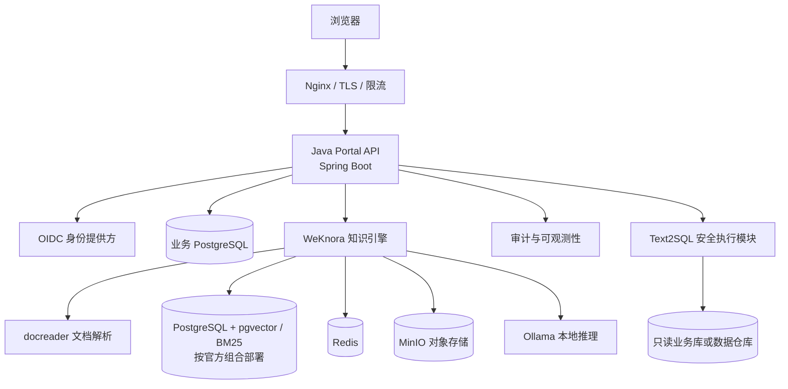
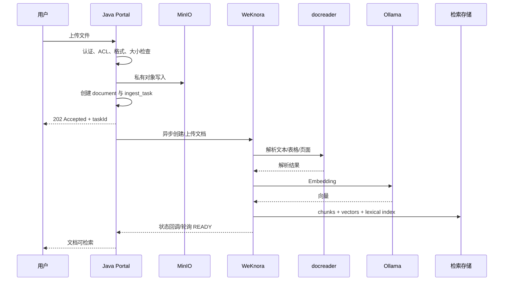
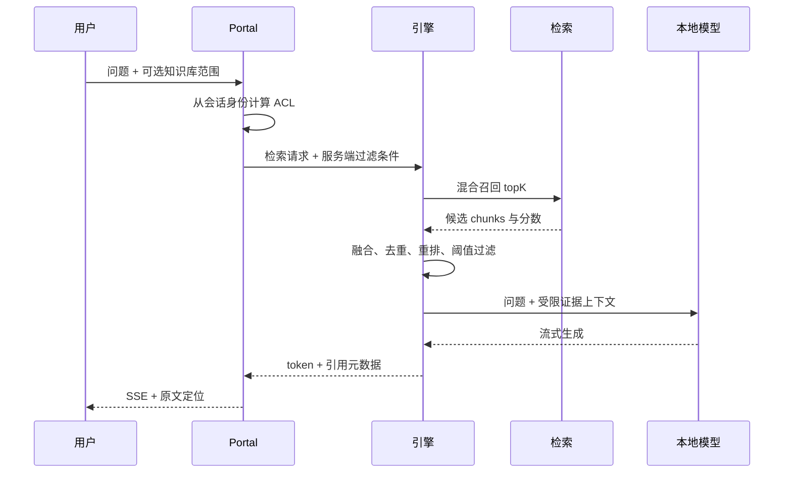
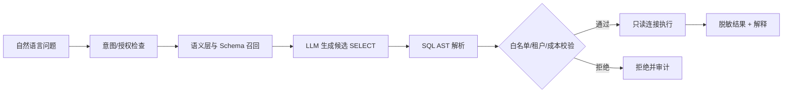

# 本地知识库完整实现技术方案

**文档版本：** 1.0  
**日期：** 2026-10-31  
**部署约束：** 本地 Docker Compose、数据留在内网、Java 业务层、本地模型  
**规模基线：** 50 人以内团队（硬件和并发需在 P0 验证）

## 方案摘要

建议采用 WeKnora 作为知识引擎、Spring Boot 作为 Java 业务门户、Ollama 作为本地模型服务。Java 业务层采用 Spring Boot + MySQL + MyBatis，MinIO 保存原始文件，Redis 用于缓存/短期协调，Kafka 承载异步入库事件；知识引擎内部存储按其官方支持的组合独立部署，不与业务 MySQL 混用。Java 层负责身份、组织权限、审批、审计、文档生命周期和 Text2SQL 安全边界；知识引擎负责文档解析、切分、索引、检索与 RAG。RAGFlow 作为复杂扫描件、表格或版式文档的备选解析引擎，只有在真实语料评测未达标时再引入。

本文是一份可实施的架构基线，不是某一硬件上的性能保证。所有容器镜像、模型和依赖版本必须在 P0 阶段按官方兼容矩阵锁定，生产部署不得使用 `latest` 标签。下文提到的估算目标都要以真实文档和目标机器复核。

## 文档导航

1. [需求与技术边界](#1-需求与技术边界)
2. [成熟方案与选型](#2-成熟方案与选型)
3. [总体架构](#3-总体架构)
4. [服务部署与 Docker 网络](#4-服务部署与-docker-网络)
5. [Java 工程结构](#5-java-工程结构)
6. [数据模型与状态管理](#6-数据模型与状态管理)
7. [文档入库流程](#7-文档入库流程)
8. [检索问答流程](#8-检索问答流程)
9. [API 规范](#9-api-规范)
10. [权限与安全](#10-权限与安全)
11. [Text2SQL 安全设计](#11-text2sql-安全设计)
12. [模型与检索质量](#12-模型与检索质量)
13. [运维、备份与升级](#13-运维备份与升级)
14. [测试与验收](#14-测试与验收)
15. [分期交付路线图与开发计划](#15-分期交付路线图与开发计划)
16. [风险清单与决策记录](#16-风险清单与决策记录)
17. [参考资料](#17-参考资料)

## 1. 需求与技术边界

| 维度 | 确认约束 |
|---|---|
| 部署 | 本地 Docker Compose，业务数据保留在内网 |
| 技术栈 | Java/Spring Boot 业务门户，成熟引擎承担文档 RAG |
| 模型 | 本地推理优先，禁止静默回退公网模型 |
| 规模 | 50 人以内团队；硬件与并发在 P0 验证 |
| 能力 | 文档问答、知识协作、权限隔离、审计、受控 Text2SQL |

### 1.1 范围与非目标

首期交付包含用户认证、空间/知识库管理、文档上传和异步入库、检索问答与来源引用、权限审计、Compose 部署和备份恢复。Wiki 审核协作与 Text2SQL 分阶段建设。首期不承诺多节点高可用、任意 SQL Agent、跨地域容灾或自动将敏感数据发送到云模型。

### 1.2 方案假设

用户规模小于 50 人但实际并发未知；知识库文档量和文件类型需通过样本盘点确认；能提供本地模型所需 CPU/GPU、内存和磁盘；身份认证可接入现有 OIDC，若无则需单独选型。任何假设变化都可能影响模型、存储和部署拓扑。

## 2. 成熟方案与选型

| 项目 | 强项 | 部署/技术特点 | 本方案中的位置 |
|---|---|---|---|
| WeKnora | 知识管理、RAG、Wiki/知识图谱及工作空间协作 | Docker Compose；引擎为独立服务，Java 通过 API 集成 | 推荐主知识引擎，P0 先验证版本、权限和文档格式 |
| RAGFlow | 深度文档解析、OCR/表格、混合检索与引用 | Docker Compose；组件和资源要求相对较高 | 复杂版式文档的备选解析/检索服务 |
| MaxKB | 开箱即用知识库与智能体 | Docker；后端 Python/Django，许可证需评估 | 快速试用，不作为 Java 代码底座 |
| Dify | 通用 LLM 应用、工作流和模型集成 | Docker Compose；主要通过 API 与 Java 集成 | 工作流/应用平台对照方案 |
| FastGPT | 中文知识库应用、知识库 API、OpenAPI | Docker Compose；其官方文档给出 pgvector 等部署选项 | 中文应用/API 对照方案 |
| Spring AI | Java 模型、向量库、RAG 组件 | Java 库，不是完整知识库产品 | Java 门户的 AI 集成框架 |

主方案采用 WeKnora + Java 门户，依据是少团队可复用成熟引擎，同时把组织、审批、审计和数据问答控制在 Java。RAGFlow 在复杂文档解析评测失败时再引入，避免首期承担两套引擎的升级、存储和运维成本。MaxKB、Dify、FastGPT 可用于 P0 横向对照，但其主体技术栈并非 Java。许可条款、组件版本与资源需求均须在正式部署前核验。

| 选择维度 | P0 验证方法 |
|---|---|
| 文档解析 | 同一组 PDF、扫描件、DOCX、XLSX、PPTX 导入比较，人工核对页码、表格、标题和文本完整性 |
| 检索质量 | 固定问题集，标注正确来源片段，测 Recall@5、MRR、引用支持率 |
| 本地化 | 断开公网后验证模型加载、解析、检索、问答是否完整可用 |
| 权限 | 构造跨租户、跨空间和文档 ACL 的反例，验证检索前过滤及结果复核 |
| 运维 | 记录镜像数量、内存/磁盘/GPU 峰值、备份恢复操作和升级回滚难度 |
| 合规 | 审核项目许可证、模型权重条款、镜像来源及内部/外部分发方式 |

## 3. 总体架构

### 3.0 已定实施决策

| 领域 | 决策 |
|---|---|
| 身份与会话 | 同源 HttpOnly、Secure、SameSite=Lax Cookie；OIDC Authorization Code 由 Java 后端处理，变更请求校验 CSRF。Java 是身份、租户、成员关系与授权唯一事实源。 |
| 引擎身份 | Java 以独立最小权限服务身份调用 WeKnora；客户端提交的 tenant/ACL 不可信。Java 按会话构造授权范围，召回阶段过滤后逐条校验 chunk 的 tenant、workspace、KB、文档版本和 ACL。未经复核的 chunk 不进入 Prompt。 |
| 原件主存储 | MinIO 是原始文件唯一权威副本。Java 写入私有 bucket 并计算 SHA-256，再由异步 worker 上传引擎；引擎对象为可重建副本。显式映射 document/version、object key、engine_doc_id。 |
| API 契约 | OpenAPI 3.1 为 REST 唯一契约来源；冻结 SSE schema、事件样例和错误码，前端据此生成 TypeScript 客户端。 |
| MVP 范围 | P1 仅交付登录、空间/成员基础、知识库、文档上传入库/状态/删除、问答/引用/反馈、审计基础和 Compose。Wiki 为 P2，Text2SQL 为 P3。 |
| 恢复策略 | 业务库、引擎库、MinIO 按一致性检查点协调备份；未通过隔离环境恢复演练不得宣称备份可用。 |

若 WeKnora 无法在召回阶段可靠执行服务端范围过滤，P0 不得直接上线；须按权限边界拆分知识库或增加 Java 授权检索隔离层，并重跑越权用例。二次过滤后候选不足，只能在授权范围补召回，否则按无依据处理。



| 层次 | 组件 | 职责与边界 |
|---|---|---|
| 接入层 | Nginx/Traefik、OIDC | TLS、请求体大小、SSE 转发、限流、统一认证 |
| Java 业务层 | Spring Boot、Spring Security | 用户/租户/空间、授权、工作流、API、审计、Text2SQL |
| 知识引擎层 | WeKnora、docreader、检索存储 | 文档解析、索引、混合检索、重排、问答、引用 |
| 基础设施层 | PostgreSQL、Redis、MinIO、Ollama | 元数据、任务、对象、推理；全部位于 Docker 私有网络 |

Java 门户与知识引擎通过适配器接口通信，不直接依赖引擎内部数据库表。WeKnora、模型和存储升级时先在预发布环境验证 API、迁移和权限语义。

### 3.1 技术栈基线

| 模块 | 建议 | 说明 |
|---|---|---|
| Java | OpenJDK 21 LTS | 运行时基线 |
| Web/安全 | Spring Boot 3.x、Spring Security 6 | 具体维护版本按组织标准与兼容矩阵选定 |
| AI 框架 | Spring AI | 模型抽象、Embedding、Java 端未来扩展；首期不重复实现引擎的完整 RAG |
| 业务库 | PostgreSQL | 用户映射、空间、状态、会话、审计、语义层 |
| 检索库 | WeKnora 官方 Compose 采用的 pgvector/ParadeDB 组合 | 不擅自替换或共享引擎数据库实例 |
| 对象存储 | MinIO | 原始文档和导出文件；私有 bucket |
| 本地推理 | Ollama；高并发时评估 vLLM | 通过内网 API 调用，固定模型名和校验信息 |
| 前端/入口 | Vue 3、Nginx | 统一门户，SSE 转发需关闭代理缓冲 |
| 数据库迁移 | Flyway | 业务 schema 版本化 |
| 部署 | Docker Compose v2 | 单机首期部署，配置与数据卷持久化 |

## 4. 服务部署与 Docker 网络

### 4.1 容器清单

| 容器 | 必需 | 网络/端口原则 | 持久化 |
|---|---|---|---|
| proxy | 是 | 唯一对宿主机发布的 HTTP(S) 入口 | TLS 配置、访问日志 |
| portal-web | 是 | 仅 proxy 可访问 | 静态文件可随镜像发布 |
| portal-api | 是 | proxy 可入站；仅内网访问其他服务 | 临时目录只读/ tmpfs |
| weknora-app | 是 | 仅 backend 网络；不直接暴露公网 | 配置及引擎数据按官方拓扑 |
| docreader | 是 | 仅引擎内部网络 | 解析临时目录有容量限制 |
| business-db | 是 | 不发布宿主机端口 | named volume + 备份 |
| engine-db | 按官方拓扑 | 不发布宿主机端口 | 单独卷；不得手工改内部表 |
| redis | 是 | 不发布宿主机端口 | 按其作为缓存/队列角色决定 AOF |
| minio | 是 | API 仅内网；控制台仅管理员网段 | 对象卷 + 备份策略 |
| ollama | 本地模型必需 | 仅 backend 网络 | 模型权重卷 |

建立 `frontend` 与 `backend` 两个 network。浏览器访问 proxy；proxy 访问门户；门户访问业务库和引擎 API；引擎访问自己的数据库、Redis、MinIO、模型服务。数据库、Redis、MinIO 管理端口和 Ollama API 不绑定 `0.0.0.0`。

### 4.2 Compose 结构示例

以下仅展示 Java 门户及业务数据库的结构。知识引擎相关服务应从锁定版本的 WeKnora 官方 Compose 文件引入，保持其服务名、健康检查和卷定义一致。

```yaml
services:
  portal-api:
    image: local/knowledge-portal:${APP_VERSION}
    restart: unless-stopped
    environment:
      SPRING_PROFILES_ACTIVE: docker
      DB_URL: jdbc:postgresql://business-db:5432/knowledge
      ENGINE_BASE_URL: http://weknora-app:8080
      OLLAMA_BASE_URL: http://ollama:11434
    env_file: [.env]
    depends_on:
      business-db:
        condition: service_healthy
    networks: [frontend, backend]
    read_only: true
    tmpfs: [/tmp]
    healthcheck:
      test: [CMD, curl, -fsS, http://localhost:8080/actuator/health/readiness]
      interval: 20s
      timeout: 3s
      retries: 5

  business-db:
    image: pgvector/pgvector:<validated-tag>
    restart: unless-stopped
    environment:
      POSTGRES_DB: knowledge
      POSTGRES_USER: knowledge_app
      POSTGRES_PASSWORD_FILE: /run/secrets/db_password
    secrets: [db_password]
    volumes:
      - business_db:/var/lib/postgresql/data
    networks: [backend]
    healthcheck:
      test: [CMD-SHELL, pg_isready -U knowledge_app -d knowledge]
      interval: 10s
      timeout: 3s
      retries: 10

  ollama:
    image: ollama/ollama:<validated-tag>
    restart: unless-stopped
    volumes: [ollama_models:/root/.ollama]
    networks: [backend]

volumes:
  business_db:
  ollama_models:
networks:
  frontend: {}
  backend:
    internal: true
secrets:
  db_password:
    file: ./secrets/db_password.txt
```

正式 Compose 需要补齐 proxy、前端、引擎及依赖，并逐项确认 healthcheck、资源限制、GPU 运行时、日志轮转和优雅关闭。`.env` 仅存非敏感配置；口令、OIDC client secret、对象存储密钥通过 Docker secrets 或受控密钥管理提供。数据库初始化完成后移除默认凭据。

### 4.3 离线安装

准备离线交付包时需包含固定版本镜像归档、Compose 文件、模型权重及校验和、初始化 SQL/Flyway、配置样例和操作手册。导入镜像后运行 SHA-256 校验；在断网环境验证首次启动、模型加载、入库、检索、问答及恢复流程。应用启动不得依赖拉取在线模型或外部字体/解析资源。

## 5. Java 工程结构

```text
knowledge-portal/
├── pom.xml
├── src/main/java/com/acme/knowledge/
│   ├── auth/             # OIDC 主体映射、会话
│   ├── tenant/           # 租户、组织、用户
│   ├── workspace/        # 空间成员及角色
│   ├── knowledgebase/    # 知识库生命周期、引擎映射
│   ├── document/         # 上传、版本、入库任务
│   ├── chat/             # 检索编排、SSE、引用、反馈
│   ├── engine/           # KnowledgeEnginePort 与 WeKnoraAdapter
│   ├── wiki/              # 草稿、审核、发布、版本
│   ├── text2sql/          # 语义层、AST 校验、只读执行
│   ├── audit/             # 审计事件
│   └── common/            # API 错误、追踪 ID、统一校验
├── src/main/resources/db/migration/  # Flyway migrations
└── src/test/java/com/acme/knowledge/
```

控制器只处理协议、输入校验和响应映射。授权、状态转换和跨系统补偿位于应用服务层；数据库访问封装在 Repository。跨服务调用通过 `KnowledgeEnginePort` 接口，不能在业务代码散落 URL、引擎 ID 字段映射和重试策略。

### 5.1 依赖边界

使用 Spring Boot 管理的 starter 和 BOM，不重复固定受 BOM 管理的版本。初始依赖至少包括 Web、Validation、Security、OAuth2 Client/Resource Server、Actuator、PostgreSQL JDBC、Flyway、OpenAPI；按需加入 Spring AI 和 Resilience4j。Spring AI 版本必须与所选 Spring Boot/JDK 验证兼容。WeKnora 负责完整文档 RAG 时，不应再引入第二套不一致的分块和向量数据作为事实来源。

## 6. 数据模型与状态管理

业务数据库通过 Flyway 管理。每张业务表使用 UUID 主键、`created_at`、`updated_at`；多租户数据强制包含 `tenant_id`。用户身份主键使用 OIDC `(issuer, subject)`，不得用可变邮箱作为唯一身份。

| 表 | 关键字段 | 主要约束/索引 |
|---|---|---|
| tenant | id, code, name, status | code 唯一 |
| app_user | id, issuer, subject, tenant_id, display_name, status | issuer+subject 唯一 |
| workspace | id, tenant_id, code, name, owner_user_id | tenant_id+code 唯一 |
| workspace_member | workspace_id, user_id, role | workspace_id+user_id 唯一 |
| knowledge_base | id, tenant_id, workspace_id, engine, engine_kb_id, classification, status | tenant/workspace/status 索引 |
| document | id, tenant_id, kb_id, object_key, mime_type, size_bytes, sha256, version, status, engine_doc_id | kb_id+sha256+version 唯一 |
| ingest_task | id, document_id, task_type, status, attempts, next_run_at, error_code | status+next_run_at 索引 |
| conversation | id, tenant_id, workspace_id, user_id, title | user_id+created_at 索引 |
| chat_message | id, conversation_id, role, content, citations_json, model_id, latency_ms | conversation_id+created_at 索引 |
| wiki_page | id, tenant_id, workspace_id, title, body, status, revision, source_refs | workspace+status 索引 |
| audit_event | id, tenant_id, actor_id, action, resource_type/id, request_id, ip, created_at | tenant/time、resource/time 索引 |
| text2sql_semantic | id, tenant_id, datasource_id, object_name, description, allowlist, metadata_json | tenant/datasource 索引 |

`engine_doc_id` 和 `engine_kb_id` 是远端引用。引擎内部 chunk、向量和索引只由引擎管理；业务库可保存必要的引用摘要用于追踪，但不要通过 SQL 修改引擎内部表。

### 6.1 文档状态机


跨系统上传、索引、重试和删除按 Saga 执行，不假设 PostgreSQL、MinIO、WeKnora 间存在分布式事务。每步记录 operation_id、远端 ID、幂等键、尝试次数和完成标记；worker 用租约安全重放。删除先冻结该版本检索，再请求引擎删除并验证检索不可见，随后进入 MinIO 保留期并按策略清理。失败标记 `COMPENSATION_REQUIRED` 并告警。每日对账文档、对象 key、引擎 ID/状态，生成孤儿对象/索引清单及受审计修复入口。

```text
UPLOADED -> QUEUED -> PARSING -> INDEXING -> READY
                   |          |          |
                   +----------+----------+-> FAILED
READY -> DELETING -> DELETED
```

任务按 document/version 幂等，记录 task_id、attempt、开始/结束时间及错误码。仅对网络暂错、模型限流、引擎暂不可用进行指数退避重试；格式不支持、解密失败、空文档等永久错误需用户修复。删除采用补偿流程：先标记 `DELETING`，删除引擎文档，确认成功后删除对象或进入保留期，再标记 `DELETED`。

## 7. 文档入库流程



处理要求：

1. 校验用户对 workspace/knowledge base 的写权限；客户端提交的 tenant_id 不作为授权依据。
2. 校验扩展名、MIME、文件签名、最大大小；文件名仅用于显示，存储键使用随机 UUID。压缩包按解压后大小和文件数限制，防止 Zip Bomb。
3. 原件写入私有 MinIO bucket 并计算 SHA-256；重复文件策略明确为拒绝、复用或新版本，不能隐式覆盖。
4. 数据库事务只创建文档和任务并返回 202；解析和向量化由异步 Worker 完成，不占用上传请求线程。
5. 引擎调用携带稳定幂等键和租户/空间/密级等 metadata；保存引擎 ID 和状态。
6. `READY` 后通知用户；失败保留安全错误摘要和内部 trace，不向用户回显堆栈或模型响应。
7. 重新索引记录 parser、chunker、embedding 模型及配置版本；更换向量模型须有重建索引计划。

第一版可以采用数据库任务表配合 `SELECT ... FOR UPDATE SKIP LOCKED` 的有界 Worker，避免增加 Kafka。任务表需要租约超时、重复投递保护、最大重试次数和人工重放入口。

## 8. 检索问答流程



推荐链路为查询改写（可选）→ 向量与关键词并行召回（服务端 ACL 前置过滤）→ RRF/引擎融合 → 去重与重排 → Java ACL 二次过滤 → token 预算内组 Prompt → 流式生成 → 保存答案和引用。初始参数可用候选 Top-K 20、最终上下文 4–8 段作为评测起点，最终阈值按真实语料校准。过滤后不足时只可在授权范围扩大召回，不能回退到无过滤检索。

### 8.1 无依据处理和引用

若召回结果为空或低于校准阈值，返回“当前授权知识库中没有检索到足够依据”，而不是要求模型猜答。引用只能从检索结果生成，包含 `document_id`、版本、标题、页码/章节、chunk 标识和原文片段；UI 点击引用前再次验证当前用户 ACL 和文档版本。模型不能自行生成引用 URL 或来源名称。

### 8.2 对话上下文

会话历史仅保留必要轮次，按模型 token 预算裁剪。历史消息不扩大用户权限；每轮检索都根据当前用户和当前授权范围重新构造过滤条件。删除用户或撤销空间成员权限后，后续检索立即失效；历史答案的访问也按会话 ACL 再校验。

## 9. API 规范

统一前缀 `/api/v1`，JSON UTF-8。分页 `page/size`，`size` 最大 100。所有响应包含 `traceId` 或由响应头提供。错误结构：

```json
{
  "code": "DOCUMENT_FORMAT_UNSUPPORTED",
  "message": "文件格式不受支持",
  "traceId": "01J...",
  "details": []
}
```

| 方法与路径 | 用途 | 主要权限 |
|---|---|---|
| POST `/workspaces` | 创建空间 | workspace:create |
| GET `/workspaces` | 列出当前用户空间 | workspace:read |
| POST `/workspaces/{id}/knowledge-bases` | 建知识库 | workspace:manage |
| POST `/knowledge-bases/{id}/documents` | 上传文档，multipart | kb:write |
| GET `/documents/{id}` | 查状态和元数据 | kb:read |
| POST `/documents/{id}/retry` | 重试失败任务 | kb:write；仅 FAILED |
| DELETE `/documents/{id}` | 异步删除 | kb:delete |
| POST `/chat/completions` | RAG 问答 | chat；SSE/JSON |
| POST `/chat/completions/{requestId}/cancel` | 取消生成 | 当前请求所有者 |
| GET `/citations/{id}/content` | 授权后流式预览原文 | 文档 `kb:read`；不暴露对象存储 URL |
| POST `/chat/completions/{requestId}/cancel` | 取消生成 | 当前请求所有者 |
| GET `/citations/{id}/content` | 授权后流式预览原文 | 文档 `kb:read`；不暴露对象存储 URL |
| GET `/conversations/{id}/messages` | 会话历史 | 所有者或管理员 |
| POST `/messages/{id}/feedback` | 答案反馈 | 会话成员 |
| POST `/wiki/pages` | 创建草稿 | wiki:write |
| POST `/wiki/pages/{id}/submit` | 提交审核 | wiki:write |
| POST `/wiki/pages/{id}/publish` | 审核发布 | wiki:approve |
| POST `/text2sql/query` | 受控数据查询 | text2sql:execute |

### 9.1 问答请求与 SSE

```http
POST /api/v1/chat/completions
Content-Type: application/json
Accept: text/event-stream
```

```json
{
  "workspaceId": "uuid",
  "knowledgeBaseIds": ["uuid"],
  "conversationId": "uuid",
  "question": "报销审批需要哪些材料？",
  "stream": true
}
```

响应事件依次可包含 `sources`、`token`、`done`、`error`。Nginx 对 SSE 禁用 response buffering，设置合理的 idle timeout；客户端断开时取消可取消的模型请求。引用事件先发送来源元数据，token 事件只发增量正文。


契约固定如下：请求携带 UUID `Idempotency-Key`；服务端创建并返回 `requestId`、`messageId`。首次提问可不带 `conversationId`，新会话 ID 在 `meta` 事件返回。事件为 `meta`（会话/消息/请求 ID）、`sources`（ACL 复核后的引用数组）、`token`（增量文本）、`done`（最终状态及 usage）、`error`（稳定业务 code、可展示 message、traceId），每个事件带递增 `seq`。相同幂等键重试返回同一请求状态，不重新生成。默认不续传；断线将消息标记 `INTERRUPTED`，用户主动发起新请求才重新生成。取消端点置 `CANCELLED` 并尽力停止引擎任务。所有 SSE 使用同源 Cookie 和 CSRF 校验。

上传采用单文件 multipart，初始限制 100 MiB/文件、3 个并发请求，最终值由 P0 容量测试确认；超限返回 413。每文件带 `Idempotency-Key`，按 SHA-256、KB 和版本策略去重。MVP 不支持分片。成功返回 202、`documentId` 和 `taskId`；状态轮询支持 ETag/If-None-Match。

## 10. 权限与安全

### 10.1 权限模型

| 层次 | 主体 | 控制范围 |
|---|---|---|
| 租户 | 租户管理员、平台管理员 | 数据隔离、用户生命周期、配额 |
| 工作空间 | Owner、Admin、Contributor、Viewer | 成员、知识库和协作操作 |
| 知识库/文档 | ACL、密级标签 | 阅读、编辑、下载、删除和分享 |

Java 业务库是组织、用户、成员关系和审批状态的事实源。通过 OIDC 主体映射关联引擎用户；角色同步和失败补偿需要可观测。检索权限过滤必须由服务端根据 ACL 构造，不能直接相信前端传来的 KB ID；引擎结果返回后再次校验。高密级数据优先拆分独立知识库/空间，降低过滤配置错误的影响。

权限变更通过事务性 outbox 同步引擎元数据；同步确认前 Java 本地过滤或拒绝该范围检索，保证撤权即时生效。前端 workspaceId/knowledgeBaseIds 只是范围提示，须与主体可访问集合求交。引用预览由 Java 授权代理提供，不生成长期对象存储链接。

### 10.2 安全控制清单

| 控制项 | 实现要求 |
|---|---|
| OIDC | Authorization Code；验证 issuer、audience、签名、nonce；短时 token 与安全 Cookie 策略 |
| 默认拒绝 | 每个资源操作校验 tenant、workspace 成员与具体权限；拒绝默认 |
| 检索隔离 | ACL filter 前置；结果二次过滤；权限变更立即生效 |
| 上传安全 | allowlist、签名校验、大小限制、杀毒、随机对象键、私有桶 |
| 网络 | 数据库/Redis/MinIO/Ollama 不发布公网；内部服务独立网络 |
| Secret | Docker secrets 或受控密钥库；日志和异常不打印凭据 |
| 数据保护 | TLS、加密磁盘/备份、最小权限数据库账号、备份访问控制 |
| 提示注入 | 文档内容是数据而非指令；工具白名单；模型无任意网络/命令能力 |
| 审计 | 登录、上传、下载、检索、问答、导出、删除、ACL 变化、SQL 执行 |
| API 防护 | 上传限流、问答并发上限、CORS allowlist、CSRF 策略、请求 ID |

审计日志包含主体、tenant/workspace/resource、动作、结果、时间、来源 IP、traceId；不记录原文、密码、token、完整 Prompt 和敏感查询结果。日志留存期限由组织策略确定。

## 11. Text2SQL 安全设计

Text2SQL 与文档 RAG 分开部署和授权。首期仅对批准的数据源和问题类型开放，流程为：



实施约束：

- 用语义层定义表、字段、业务别名、指标口径、连接关系、枚举、租户键和允许聚合；只向模型提供当前问题相关的 schema。
- SQL AST 库负责语法树解析。只允许单条 SELECT/批准的 CTE；表列函数均需白名单；拒绝 DDL、DML、系统目录、文件/网络函数、多语句和注释混淆。
- 租户谓词由服务端强制注入或使用 RLS；绝不能依赖模型自己生成租户条件。
- 使用独立只读账号和只读副本；数据库层设置 statement timeout、最大并发、最大行数和连接池上限。
- 显示查询时间、数据口径和结果来源；敏感列脱敏。执行前可按风险等级要求人工确认。
- 正则表达式不能作为唯一 SQL 安全控制；AST 无法解析、规则冲突或超时一律拒绝执行。
- 记录问题、规范化 SQL、用户、数据源、执行时间、行数、拒绝原因和反馈，避免记录敏感结果正文。

## 12. 模型与检索质量

| 用途 | 初始候选 | 选择方式 |
|---|---|---|
| 中文聊天 | Qwen 系列或经本地评测的兼容模型 | 按硬件、中文指令、上下文长度、吞吐和许可证选型 |
| Embedding | BGE-M3 或 Qwen Embedding 系列 | 以 Recall@K 和中文专业语料效果选择；固定向量维度 |
| Reranker | BGE Reranker 系列 | 对候选段落精排；记录耗时和引用提升 |
| 推理服务 | Ollama 起步，vLLM 备选 | Ollama 运维简单；达到并发/延迟瓶颈后压测切换 |

模型参数不能只依据参数量推算硬件。显存还受量化、KV cache、上下文长度、并发、Embedding/Reranker 共置等影响。P0 用实际模型权重做冷启动和持续负载测试，记录峰值显存、RAM、磁盘及响应时间。

质量集至少覆盖 FAQ、精确术语/编号、跨页、表格、长文档、无答案问题、跨知识库权限、过期版本和提示注入。对每次 parser、chunker、embedding、reranker、prompt 或模型变更跑回归，重点看 Recall@5、MRR、引用支持率、无依据回答率、首 Token P95 和完整响应 P95。

## 13. 运维、备份与升级

### 13.1 可观测性

| 类别 | 指标 |
|---|---|
| API | 请求量、错误率、P50/P95、上传大小、SSE 中断 |
| 入库 | 队列积压、各阶段耗时、失败率、重试数、解析字节量 |
| 检索 | 候选数、检索/重排耗时、ACL 过滤数、无证据率 |
| 模型 | 首 Token/总生成延迟、token 数、并发排队、GPU 利用率/显存 |
| 存储 | 数据库连接与磁盘、Redis 内存、MinIO 容量、卷增长率 |
| 安全 | 登录失败、越权拒绝、导出、Text2SQL 拒绝/执行 |

日志结构化并通过 traceId 串联门户、引擎和模型调用；仅记录必要元数据，不记录文档正文和敏感 Prompt。Prometheus/Grafana、Langfuse 等为可选观测组件，部署前评估其额外资源和数据保留策略。

### 13.2 备份恢复

| 数据 | 备份 | 恢复验证 |
|---|---|---|
| 业务 PostgreSQL | 定时全备；按 RPO 决定 WAL/PITR | 隔离环境恢复并验证 ACL、任务及审计 |
| 引擎数据库 | 遵循 WeKnora 官方一致性备份方案 | 确认 KB、文档、索引和引用关系可用 |
| MinIO | 对象复制/版本化或离线同步 | 校验对象 hash 和抽样下载 |
| 模型文件 | 模型清单、版本、SHA-256 与离线备份 | 干净启动完成推理 |
| 配置 | Compose、非密钥配置纳入版本管理；Secret 单独备份 | 使用恢复的 Secret 完整重建 |

同时制定 RPO/RTO。没有恢复演练的备份不算已验证。引擎数据库和对象存储需按一致性要求协调快照时间，避免备份中存在索引引用但原文件缺失的状态。

一致性检查点：暂停上传、删除、重建并等待在途任务收敛；记录 checkpoint_id；备份业务库、引擎库和 MinIO 对象清单/版本；恢复后核对 document/version、对象 SHA-256、engine_doc_id 和引用关系。若引擎索引不能保证一致恢复，则恢复业务库和 MinIO 后从权威原件重建。P0 暂定 RPO≤24 小时、RTO≤8 小时，业务负责人确认后列为上线门槛；隔离恢复演练须记录耗时和抽样 hash。

### 13.3 升级/回滚

1. 锁定新版本镜像与变更说明，评估 API、数据迁移、模型和向量维度影响。
2. 备份业务库、引擎库和对象存储；保留原镜像及配置。
3. 在克隆环境升级，跑入库、权限、检索、引用、删除和备份恢复回归。
4. 维护窗口中升级并观测队列、错误率和质量指标。
5. 若发生不兼容，按预案停写、恢复快照并运行原镜像。不能假设数据库迁移可向下执行。

## 14. 测试与验收

| 类别 | 测试项 | 建议基线 |
|---|---|---|
| 功能 | 上传/状态/失败重试/版本/删除/引用跳转 | 核心流程全部通过 |
| 格式 | PDF、DOCX、XLSX、PPTX、MD、扫描 PDF | 以业务真实格式清单逐项记录能力 |
| 检索 | 核心问题 Recall@5 | 建议 ≥85%，按标注语料校准 |
| 回答 | 引用支持率 | 建议 ≥90%；无依据问题需拒答 |
| 权限 | 跨租户/空间/KB/文档越权用例 | 越权读取 0 例 |
| Text2SQL | 基准问题成功率/危险语句拦截 | 成功率目标按场景设定；危险语句拦截 100% |
| 性能 | 首 Token、完整回答、上传与索引耗时 | P0 后设硬件相关 SLO |
| 离线 | 断外网启动、入库、问答 | 无公网依赖及外发请求 |
| 灾备 | 数据、对象、模型恢复和回滚 | 完成隔离环境恢复演练 |

测试组合包括单元测试、API 集成测试、Compose 端到端测试、ACL 负向测试、检索评测、SQL 攻击测试、压力测试和灾备演练。建议先用 50–100 份经脱敏的真实文档和至少 100 个标注问题完成 P0。P0 输出容量与质量基线：以 5 并发起测，建议首 Token P95≤8 秒、完整回答 P95≤45 秒、Recall@5≥85%、引用支持率≥90%、越权读取 0 例，并记录入库吞吐、存储增长和恢复时间。时延建议须在目标机器确认；未达标则调整模型、并发或硬件并重测，禁止静默回退公网模型。

## 15. 分期交付路线图与开发计划

### 15.1 分期原则

每期都形成可运行、可验收的增量；后一期不得以绕过前一期质量门槛的方式开始生产数据迁移。P0 是技术验证与规格冻结，不向业务用户开放；P1 形成可用 MVP；P2 增加知识治理；P3 增加受控数据问答；P4 完成上线加固。阶段长度按团队规模估算，采用 2 周迭代，P0 约 2 周、P1 约 4–6 周、P2 约 3–4 周、P3 约 4–6 周、P4 约 2–3 周；以验收结果为准，不以日历到期自动过关。

### 15.2 P0 技术验证与规格冻结（约 2 周）

**目标**：证明选型可行，关闭会导致架构返工的关键不确定性。

**开发/验证内容**：
- 盘点 50–100 份脱敏真实文档、格式/大小/扫描比例；建立至少 100 个标注问题与标准来源片段。
- 用锁定候选版本部署 WeKnora、Ollama、PostgreSQL/向量组件和 MinIO；断网验证完整流程。
- 验证 OIDC 用户映射、引擎服务身份、召回阶段 ACL 过滤、撤权即时生效和引用授权代理；构造跨租户/空间/KB/文档攻击样例。
- 测量目标机器上的解析质量、Recall@5、引用支持率、5 并发时延、GPU/RAM/磁盘峰值、入库吞吐与增长。
- 验证 MinIO 权威原件、副本重建、幂等上传/删除、引擎异常后的任务重放及一致性恢复流程。
- 冻结 OpenAPI 3.1、Cookie/CSRF、SSE event schema、状态枚举、错误码、上传上限和首期范围；建立 ADR 和镜像/模型 SHA 清单。

**交付物**：可重复启动的 P0 Compose、评测语料/问题集、ACL 负向测试记录、容量与质量基线、契约文件、组件/模型锁定清单、风险与决策记录。

**质量门槛/退出条件**：
- 越权读取 0 例；ACL 过滤在召回阶段有效，无法证明则停止 WeKnora 直接集成并先设计隔离层。
- 无公网依赖完成上传、入库、问答、引用；无静默云回退。
- 建议基线 Recall@5≥85%、引用支持率≥90%；不达标需调整解析/模型或正式接受有记录的业务阈值。
- 5 并发建议首 Token P95≤8 秒、完整回答 P95≤45 秒，或形成已批准的目标机器/SLO 例外及扩容方案。
- 完成一次隔离恢复演练；所有版本固定且无 `latest`。

**实施方案**：先做验证适配器和小型纵向切片，不建设完整产品界面；每项能力留脚本、日志、数据和可复现步骤。P0 评审通过后才冻结 P1 backlog。

### 15.3 P1 MVP 文档问答闭环（约 4–6 周）

**目标**：用户可安全登录、管理空间和知识库、上传文档并获得可追溯答案。

**开发内容**：
- 后端：OIDC Session、CSRF、用户/空间/成员授权；Flyway 业务模型；OpenAPI 生成契约；文档上传和 MinIO 原件存储；数据库任务队列与有界 worker；WeKnora adapter；状态查询/重试/删除 Saga、outbox、对账任务；问答会话、ACL 检索、引用保存/预览代理、SSE、取消/中断、反馈与审计。
- 前端：登录/会话过期、工作台、空间切换、知识库列表/详情、单文件上传队列、状态恢复、问答/会话历史、SSE 增量展示、引用侧栏和授权预览、错误/空/无权限状态、响应式布局。
- 运维：Compose、Nginx 同源代理、健康检查、资源限制、结构化 traceId 日志、备份脚本和部署手册。

**开发顺序**：先冻结 OpenAPI 和事件 schema；再完成登录/授权与业务数据模型；随后实现文件入库的可重放链路；接着完成 ACL 检索和引用；最后接入前端闭环及部署运维。后端每个纵向切片都提供 mock/集成环境供前端并行联调。

**质量门槛/退出条件**：
- 主流程 E2E：登录→创建空间/知识库→上传→READY→提问→引用打开；刷新页面后任务/会话状态可恢复。
- 跨租户/空间/知识库/文档越权读取 0 例；撤权后新检索、旧会话查看、引用预览均拒绝。
- 上传、重试、删除重复调用不产生重复索引；引擎不可用后任务可恢复；对账能发现人为构造的孤儿对象/索引。
- SSE 正常、错误、取消、断网状态均清晰；相同幂等键不重复生成；未经 ACL 校验来源不进入 UI/模型。
- 前端键盘可完成核心流程、窄屏可上传和问答；Markdown XSS 与敏感缓存检查通过。
- P0 基线在目标环境复测；无 P0 未解决安全阻断项。

### 15.4 P2 知识治理与协作（约 3–4 周）

**目标**：让知识内容有负责人、审核、版本和可追踪维护闭环。

**开发内容**：Wiki 草稿/提交/审核/退回/发布状态机；乐观锁修订、差异比较、来源引用与权限校验；知识负责人、有效期、过期提醒；纠错反馈分派；审计查询和治理视图；通知与重试；对应前端 Wiki 和管理页面。

**开发方案**：Wiki 内容只由 Java 业务库作为事实源；发布时通过幂等任务同步到检索引擎，发布/撤回使用版本号与补偿状态；审核事件和权限变更写入审计/outbox。先实现状态机和 API，再实现编辑/审核 UI。

**质量门槛/退出条件**：所有状态迁移有角色约束和审计；并发编辑冲突不静默覆盖；发布、撤回、重试均幂等；撤权/撤稿后检索按既定时限失效；来源可追溯，提醒失败可重放。

### 15.5 P3 受控 Text2SQL（约 4–6 周）

**目标**：针对批准的数据主题提供可审计、只读、限成本的数据问答。

**开发内容**：语义层与数据源注册/审批；只读账号或只读副本；schema 检索；LLM 候选 SQL；AST 解析与表/列/函数 allowlist；服务端租户谓词/RLS；成本、超时、行数及并发限制；人工确认状态；脱敏结果、SQL 展示和执行审计；前端数据问答。

**开发方案**：先用固定语义模型与基准问题集离线验证，再开放单一数据源；执行器与 RAG 隔离，模型没有数据库凭据；规则拒绝默认；每次执行产生 request ID 和审计事件，结果不写入通用日志。

**质量门槛/退出条件**：SQL 攻击集危险语句拦截 100%；跨租户测试 0 泄露；仅单条白名单 SELECT/批准 CTE 可执行；超时、最大行数、并发限制生效；基准问题正确率达到业务负责人批准阈值；拒绝、人工确认和审计链路完整。

### 15.6 P4 上线加固与运营移交（约 2–3 周）

**目标**：完成可部署、可恢复、可升级、可运维的生产交付。

**开发内容**：压测与容量上限；离线交付包和校验和；镜像漏洞/许可证核查；密钥轮换；备份、恢复、回滚演练；日志指标告警；资源/磁盘阈值；安全配置审查；操作手册、故障手册和培训。

**质量门槛/退出条件**：目标并发和 P95 达到批准 SLO；RPO/RTO 演练达到批准目标；断网冷启动和模型加载成功；无高危未处置漏洞/许可阻断；所有镜像固定版本且摘要可追溯；上线、回滚、恢复均由运维人员按手册完成。

### 15.7 跨期工程约束

- 每期采用“需求/契约评审→实现→代码审查→自动化验证→安全与质量验收→发布/回滚记录”的 Definition of Done；验收问题进入下一迭代前必须定级并有责任人。
- API 采用向后兼容演进；数据库变更使用 Flyway expand/migrate/contract，禁止未经备份验证的破坏性迁移。
- P1 起建立单元、集成、端到端、ACL 负向和检索回归；P2/P3 增加各自状态机与安全用例；P4 做完整压力和灾备演练。
- 每次更换 parser、chunker、embedding、reranker、prompt 或模型，均记录版本并重跑固定问题集；向量维度变化通过新索引并行构建和切换，不原位覆盖。
- 首期不包含 Wiki、Text2SQL、多节点高可用；任何新增范围需重新估算容量、周期和验收标准。

## 16. 风险清单与决策记录

| 风险 | 影响 | 缓解措施 |
|---|---|---|
| WeKnora 版本更新快 | 迁移/API 不兼容 | 固定版本，升级前快照并做克隆环境回归 |
| 本地模型资源不足 | 延迟高、排队 | P0 实测；限制并发和上下文；再评估量化模型或 vLLM |
| 扫描件/版式解析不达标 | 无法检索、引用偏差 | P0 样本评测；按门槛接入 RAGFlow/OCR |
| 文档 ACL 同步失败 | 越权或漏召回 | 前置过滤、结果二次校验、角色同步告警、拒绝默认 |
| 模型/Embedding 更新 | 向量不兼容 | 模型版本记录；新建索引后切换，不原位覆盖 |
| Text2SQL 语义或安全错误 | 错误数据披露/查询 | AST 白名单、只读账号、租户约束、人工确认与审计 |
| 单机故障 | 服务不可用 | 定义 RPO/RTO、外部备份介质、定期恢复演练 |
| 开源许可证约束 | 分发或商业化合规问题 | 记录各组件许可证，正式部署前由组织评审 |

### 16.1 关键决策

| 决策 | 当前选择 | 重新评估条件 |
|---|---|---|
| 主知识引擎 | WeKnora | P0 的解析、API、权限或稳定性不符合要求 |
| 复杂文档方案 | RAGFlow 作为备选 | 扫描件/表格解析达不到验收门槛 |
| Java 定位 | 身份和业务控制面 | 若决定不自研门户，可评估直接运营引擎 UI |
| 本地模型服务 | Ollama 起步 | 持续并发或延迟指标超出容量边界 |
| Text2SQL | P3 阶段的 Java 受控模块 | 语义模型/多库分析复杂度显著增长时评估 WrenAI/DB-GPT |
| 部署 | 单机 Compose | SLA、并发、团队规模要求多节点时迁移编排平台 |

## 17. 参考资料

市场调研及版本/许可证信息以原调研文档列出的官方源为准；实施前再核对版本页面与部署指南。

- [WeKnora GitHub](https://github.com/Tencent/WeKnora)
- [WeKnora 架构](https://weknora.weixin.qq.com/docs/02-architecture/01-overview)
- [WeKnora 安装部署](https://weknora.weixin.qq.com/docs/01-getting-started/02-installation)
- [RAGFlow 文档](https://ragflow.io/docs/dev/)
- [Spring AI PGVector](https://docs.spring.io/spring-ai/reference/api/vectordbs/pgvector.html)
- [Spring AI RAG](https://docs.spring.io/spring-ai/reference/api/retrieval-augmented-generation.html)
- [Docker Compose 文档](https://docs.docker.com/compose/)
- [Ollama](https://ollama.com/)


